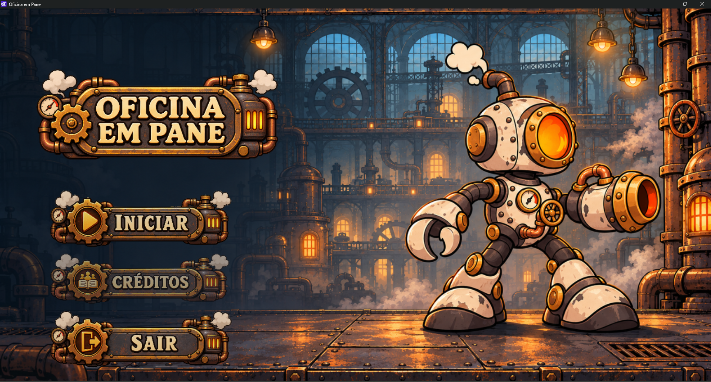
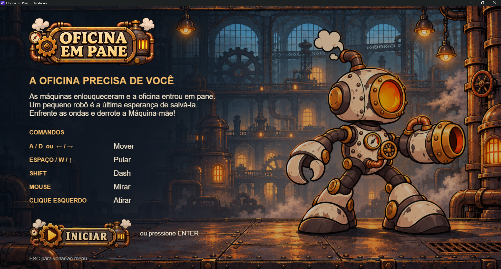
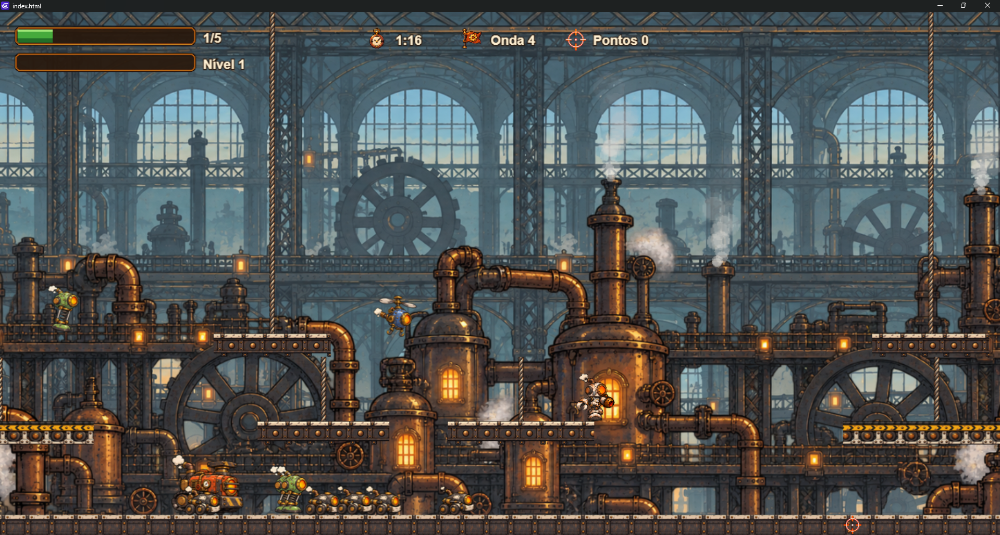
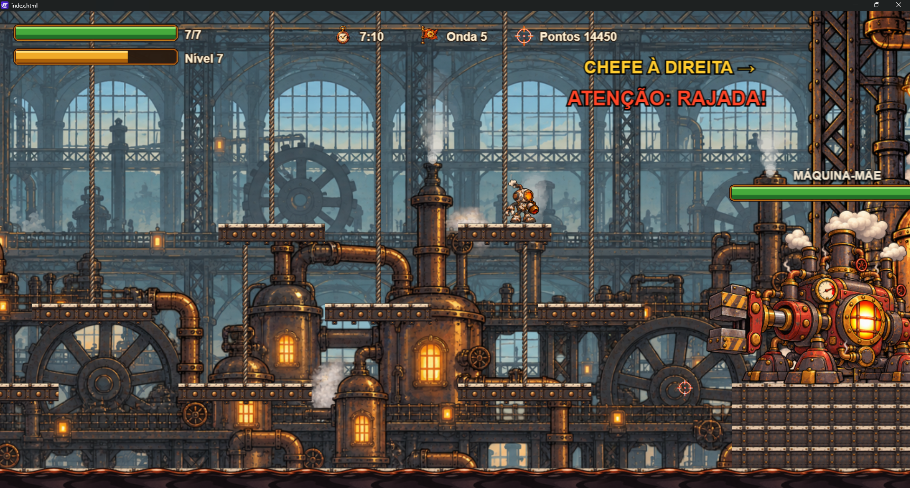
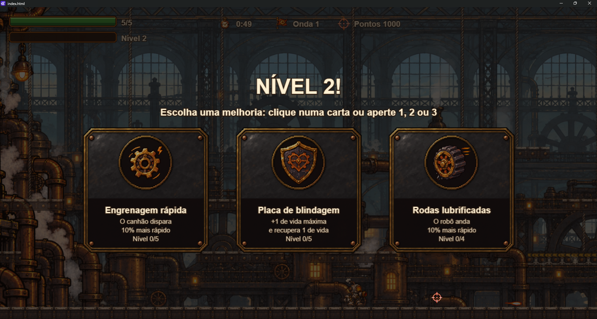
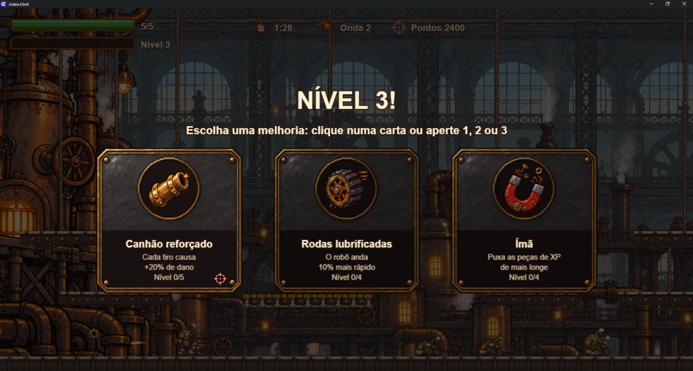
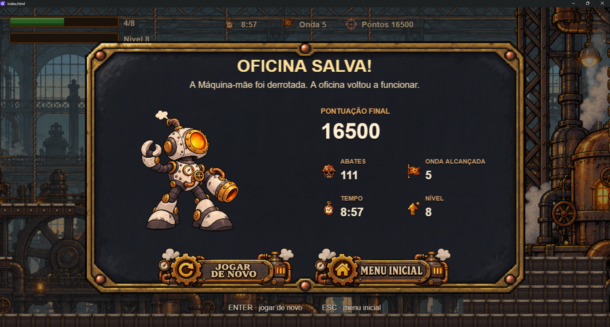
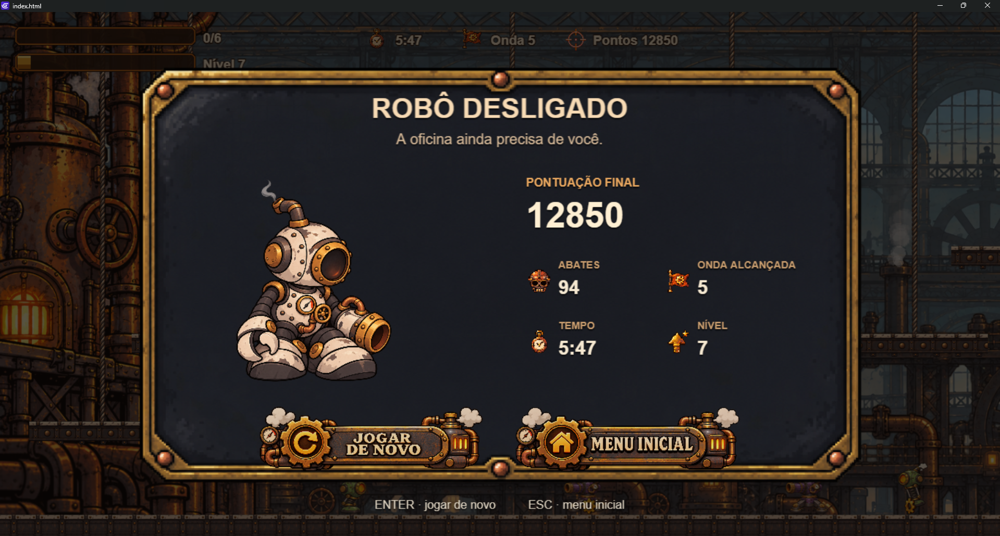

# Oficina em Pane

Projeto de jogo de plataforma 2D com hordas e progressão do protagonista por XP e melhorias, desenvolvido em GDevelop para a disciplina de Desenvolvimento de Jogos Digitais.

**Navegação:** [demonstrações](#demonstrações-do-jogo) · [como jogar](#como-jogar) · [abrir o projeto](#como-abrir-e-executar-o-projeto) · [inimigos e ondas](#inimigos-ondas-e-máquina-mãe) · [melhorias](#melhorias) · [implementação](#implementação-no-gdevelop) · [documentação e créditos](#documentação-e-créditos).

## Enredo e objetivo

As máquinas de uma oficina entraram em pane, e um pequeno robô é a última esperança de salvá-la. Para restaurar a oficina, o jogador precisa sobreviver a cinco ondas de inimigos, coletar peças de XP, escolher melhorias e derrotar a Máquina-mãe.

O combate acontece numa arena de plataformas: é preciso mirar e atirar enquanto se movimenta entre prateleiras, esteiras e andaimes. Na luta final, o óleo cobre o chão e reduz os locais seguros. A partida termina em vitória ao derrotar a Máquina-mãe ou em derrota quando a vida do robô chega a zero; as duas telas permitem jogar novamente ou voltar ao menu.

## Demonstrações do jogo

Capturas reais da versão em execução, mostrando o menu, o combate, as melhorias e os resultados da partida.

### Menu inicial

| Tela inicial | Botões do menu |
| --- | --- |
|  |  |

### Combate e Máquina-mãe

| Combate na onda 4 | Encontro com a Máquina-mãe |
| --- | --- |
|  |  |

### Progressão e melhorias

| Escolha de melhoria | Outras opções de melhoria |
| --- | --- |
|  |  |

### Resultados

| Vitória | Derrota |
| --- | --- |
|  |  |

### Vídeos de demonstração

As gravações mostram duas partidas: uma até a vitória e outra até a derrota. Os links abaixo levam aos arquivos MP4, para abrir ou baixar.

| Gravação | Duração aproximada | Arquivo |
| --- | --- | --- |
| Partida até a vitória | 5 min 26 s | [Abrir ou baixar o vídeo da vitória](midia/videos/partida-vitoria.mp4) |
| Partida até a derrota | 2 min 41 s | [Abrir ou baixar o vídeo da derrota](midia/videos/partida-derrota.mp4) |

## Como jogar

[Jogar no navegador](https://gustavomirandadoamaral.github.io/Jogo_Final/)

No menu, clique em **Iniciar**, leia a introdução e comece a partida. O fluxo é **menu → introdução → combate → vitória ou derrota → reinício ou menu**.

| Ação | Controle |
| --- | --- |
| Mover | A/D ou ←/→ |
| Pular | W, ↑ ou Espaço |
| Dash | Shift esquerdo |
| Mirar | Mover o mouse |
| Atirar | Segurar o botão esquerdo do mouse |
| Pausar ou continuar | Esc; na pausa, também há o botão Continuar |
| Escolher melhoria | Clique numa carta ou teclas 1, 2 e 3 |
| Jogar novamente após o resultado | Enter ou botão Jogar de novo |
| Voltar ao menu após o resultado | Esc ou botão Menu inicial |

Use as plataformas para se reposicionar, desça para coletar peças e escolha melhorias ao subir de nível. A aparência do robô permanece a mesma durante a partida. O botão Créditos abre uma tela com a concepção coletiva, as contribuições dos integrantes e o uso de IA. O botão Menu inicial ou Esc permite voltar.

## Como abrir e executar o projeto

**Versão de referência:** GDevelop **5.6.287**, registrada no projeto e conferida na instalação local.

1. Instale o **GDevelop desktop**.
2. Baixe o repositório pelo botão **Code → Download ZIP** no GitHub e extraia o arquivo, ou clone o repositório com Git.
3. Mantenha a estrutura das pastas: o projeto depende das imagens, sons e demais recursos incluídos no repositório.
4. No GDevelop, escolha **Abrir um projeto** e selecione `prototipo/Robot.json` dentro da pasta extraída.
5. Inicie a prévia pelo botão **Visualizar**. Se o editor pedir uma cena, escolha `MenuInicial` para percorrer o fluxo completo do jogo.
6. Clique em **Iniciar** no menu e siga a introdução. Os comandos estão na seção [Como jogar](#como-jogar).

`prototipo/Robot.json` é o projeto editável; `docs/` contém a exportação web. Não é necessário editar a exportação para abrir o fonte no GDevelop.

### Organização dos arquivos

| Caminho | Uso |
| --- | --- |
| `prototipo/Robot.json` | Projeto editável |
| `prototipo/imagens/` e `prototipo/assets/` | Imagens e quadros usados pelo jogo |
| `prototipo/sons/` | Músicas e efeitos sonoros |
| `imagens/` | Artes originais, conceitos e referências |
| `midia/` | Capturas e vídeos demonstrativos |
| `docs/` | Exportação HTML5 para publicação |

## Inimigos, ondas e Máquina-mãe

Os inimigos combinam perseguição, saltos, voo, resistência e ataques à distância para exigir movimentação entre chão e plataformas. As animações distinguem movimento e preparação de ataques; os avisos visuais dão tempo para reagir.

### Os cinco inimigos

| Inimigo | Vida inicial | Comportamento |
| --- | --- | --- |
| Andador | 8 | Persegue o robô pelo chão e causa 1 de dano por contato. Quando o robô permanece no alto, passa a patrulhar uma faixa horizontal, em vez de ficar parado embaixo dele. Pisca ao se aproximar para sinalizar o perigo |
| Saltador | 12 | Persegue o robô usando saltos para alcançar plataformas, atravessar vãos ou atacar de perto. Também pode descer por superfícies atravessáveis. Causa 1 de dano por contato e pisca próximo do herói |
| Voador | 6 | Voa em direção ao robô, sem depender das plataformas. Ao encostar ou chegar muito perto, para, pisca por 0,75 s e explode, consumindo a própria unidade. A explosão causa 2 de dano nas ondas comuns e 1 durante a luta com a Máquina-mãe |
| Pesado | 20 | Avança pelo chão, causa 2 de dano por contato e ameaça a sustentação do robô: pode provocar a queda da plataforma ocupada acima dele. A preparação do impacto tem animação e recarga para evitar quedas sucessivas imediatas |
| Atirador | 8 | Aproxima-se ou recua para manter distância, ficando voltado ao robô. Em plataformas, limita o deslocamento às bordas. Dispara projéteis que causam 1 de dano e atravessam as plataformas; os tiros têm tempo de vida limitado |

Cada inimigo recebe seu próprio `MultiplicadorVelocidade`, sorteado entre 0,5 e 1,25 da velocidade base. Isso varia a aproximação das unidades sem criar novos tipos. O dano recebido pelo robô respeita sua invulnerabilidade temporária para evitar perdas de vida a cada quadro.

### Ondas e surgimento

As ondas usam **cotas totais por tipo** e um **limite de inimigos vivos ao mesmo tempo**. Matar um inimigo libera espaço para os restantes da cota; não gera uma reposição infinita daquele tipo. Cada tipo possui seu intervalo de surgimento.

| Onda | Andadores | Saltadores | Voadores | Pesados | Atiradores | Máximo de vivos |
| --- | --- | --- | --- | --- | --- | --- |
| 1 | 10 | 0 | 0 | 0 | 0 | 8 |
| 2 | 12 | 8 | 0 | 0 | 0 | 10 |
| 3 | 10 | 8 | 4 | 0 | 0 | 10 |
| 4 | 10 | 8 | 6 | 4 | 0 | 11 |
| 5 | 0 | 12 | 8 | 0 | 8 | 16 |

Os valores representam o balanceamento atual. A próxima onda começa depois que todas as cotas foram criadas, os inimigos foram eliminados e a espera de transição terminou. Ao concluir as ondas 3 e 4, o robô recupera 1 de vida, até seu máximo.

As entradas alternam os lados e ficam fora da área visível da câmera, inclusive quando isso exige nascer além da borda da arena. A entrada dos inimigos terrestres permite atravessar o limite antes de reativar a física de plataforma. Atiradores também podem surgir em prateleiras elegíveis fora da tela, evitando limitar todos os encontros ao chão.

### Máquina-mãe

Depois de concluir a onda 5, a Máquina-mãe entra com **300 de vida**, o robô recupera toda a vida atual máxima e começa o aviso de subida do óleo. A barra acima da máquina acompanha a proporção `Vida / VidaMaxima`; um indicador ajuda a localizá-la quando está fora da câmera.

A luta reúne quatro habilidades, com avisos, recargas e mudanças na animação da máquina:

- **Rajada:** cinco projéteis visíveis, disparados em sequência com intervalo de 0,2 s e velocidade de 260 px/s. Os disparos da máquina causam 2 de dano.
- **Prensa:** marca uma plataforma ocupada, prepara o impacto e retira temporariamente sua sustentação. A plataforma retorna após o intervalo previsto para esse ataque.
- **Vapor:** marca uma posição da arena e libera uma coluna de vapor que causa dano ao robô dentro da área ativa.
- **Convocação:** cria Voadores durante a luta, acrescentando pressão enquanto o jogador desvia dos outros ataques.

Quando a vida da máquina chega a zero, `ChefaoDerrotado` sinaliza o encerramento, o óleo escoa e o jogo apresenta a vitória com pontuação, abates, onda, tempo e nível. A duração da partida depende de concluir as ondas e derrotar o chefe, não apenas de sobreviver a um relógio.

## Ciclo da partida e melhorias

O jogo controla partida, pausa, melhorias e resultados pela variável `EstadoJogo`. A implementação fica nos grupos **Ciclo da partida** e **Melhorias: efeitos** da cena `Arena`.

### Estados

| Estado | Como entra | Como sai |
| --- | --- | --- |
| `Jogando` | Início, ou ao sair de uma das telas | — |
| `Pausado` | Esc | Esc, ou clique em "Continuar" |
| `EscolhendoUpgrade` | O XP chega ao valor do próximo nível | Clique numa carta, ou teclas 1, 2 e 3 |
| `Derrota` | A vida do robô chega a 0 | Enter ou o botão "Jogar de novo" reiniciam; "Menu inicial" ou Esc voltam ao menu |
| `Vitoria` | 3,5 s depois de a Máquina-mãe cair (o tempo do escoamento) | Enter ou o botão "Jogar de novo" reiniciam; "Menu inicial" ou Esc voltam ao menu |

- **Fora de `Jogando`:** a escala de tempo vai a 0. Tudo que depende do tempo para: movimentos, comportamentos, Tweens e partículas.
- **Comandos do robô:** só funcionam em `Jogando`, e a mira também fica parada nas telas.
- **Depois de uma tela:** o tiro só volta depois de soltar o botão do mouse (`AguardandoSoltarMouse`), para o clique da carta não virar um disparo. A variável também começa em 1 em cada partida, protegendo a entrada pelo menu e o reinício pelo botão "Jogar de novo".

### XP e nível

- **Coleta:** encostar numa peça soma o `ValorXP` dela ao `XP`.
- **Nível:** quando o `XP` chega a `XPProximoNivel`, o robô sobe de nível. A sobra de XP continua valendo, e o próximo nível pede `CrescimentoXP` (5) a mais.
- **Cartas:** as três são sorteadas entre as melhorias que ainda não chegaram ao máximo. Se todas estiverem no máximo, entra o Reparo imediato.

### Melhorias

Os dados ficam no array `Melhorias` (nome, descrição, quantas vezes foi escolhida e máximo). O índice no array é o ID da melhoria e também a animação do ícone. Os efeitos ficam no grupo **Melhorias: efeitos**. Abaixo, n é o número de vezes que a melhoria foi escolhida.

| ID | Melhoria | Máx. | Efeito |
| --- | --- | --- | --- |
| 0 | Canhão reforçado | 5 | Dano do tiro 1 + 0,2n (`DanoTiro`) |
| 1 | Engrenagem rápida | 5 | Intervalo entre tiros 0,1 s ÷ (1 + 0,1n) |
| 2 | Placa de blindagem | 5 | +1 de vida máxima (`Robo.VidaMaxima`) e recupera 1 |
| 3 | Rodas lubrificadas | 4 | Velocidade × (1 + 0,1n), aplicada pela pilha de configuração do dash para o fim do dash não desfazê-la |
| 4 | Caldeira extra | 5 | Recarga do dash 3 s × 0,85ⁿ (`Robo.RecargaDash`; a recarga interna da extensão fica em 0,5 s) |
| 5 | Ímã | 4 | Peças a até 150 + 60n px voam até o robô |
| 6 | Reparo imediato | — | Recupera 1 de vida (só aparece quando as outras estão no máximo) |

### Telas

As telas ficam na camada `HUD` e acompanham a largura real da janela: o véu cobre a tela toda, e títulos, cartas e painel se centralizam pela câmera do HUD.

- **Cartas** (`Cartao`, `IconeCarta`, `TextoCartao`, `TextoDescricaoCarta`):
  - cada carta tem a moldura, o ícone da melhoria, o nome e a descrição com o nível atual;
  - a carta sob o mouse fica acesa.
- **Pausa:** mostra o resumo da partida e das melhorias, com o botão Continuar.
- **Derrota e vitória:** usam painéis próprios (`TelaDerrota` e `TelaVitoria`), com ilustração do robô, pontuação final e estatísticas com ícones. Os botões permitem reiniciar ou voltar ao menu; Enter reinicia e Esc volta ao menu.
- **Resumo e melhorias:** os ícones e textos dinâmicos do painel são criados ao abrir e removidos ao voltar ao jogo. As telas finais ocultam os elementos do painel antigo e exibem sua apresentação própria.

As artes das cartas, do painel e dos ícones são do catálogo [imagens/interface](imagens/interface/README.md).

## Implementação no GDevelop

Os detalhes abaixo apresentam a organização dos sistemas, eventos e recursos para quem vai revisar ou editar o projeto.

### Controles e combate

O sprite do robô acompanha a direção da mira, comparando `CursorX()` com `Robo.X()`. O cursor padrão é ocultado durante a partida e o objeto `Mira` é posicionado no `HUD`; o dash respeita `Robo.RecargaDash` e os limites da arena.

A navegação da tela inicial fica nos grupos **Menu adaptado a janela**, **Realce dos botoes** e **Navegacao do menu** da cena `MenuInicial`. Na cena `Arena`, a movimentação, os disparos e o dano sofrido pelo protagonista ficam concentrados no grupo **Robô**, enquanto a detecção de acertos e recompensas por abate ficam em **Combate e recompensas**. Já os efeitos sonoros são disparados nos eventos de cada respectiva ação ou inimigo, organizados por canais dedicados para evitar cortes de áudio.

#### Mira e disparos

- **Origem e trajetória:** cada disparo cria um projétil `Tiro` no ponto `"Ponta"` do objeto `Arma` (`Arma.PointX("Ponta")`, `Arma.PointY("Ponta")`) em direção ao cursor (`MouseX()`, `MouseY()`) com velocidade de **800 px/s**, acompanhado de um efeito visual rápido (`Fogo_Disparo` por 0,05 s).
- **Bloqueios de disparo:** o robô só atira quando `EstadoJogo = "Jogando"`, o robô está pronto para atirar, não está no atordoamento inicial de dano (`TempoInvulneravel <= 2`) e o botão do mouse já foi solto após cliques em menus ou cartas (`AguardandoSoltarMouse = 0`).
- **Colisão dos tiros:** ao atingir qualquer instância do grupo `Inimigos`, o projétil subtrai `DanoTiro` da variável `Vida` do alvo e é removido. Tiros que atingem o chão (`Chao`) também são deletados.

#### Dano, invulnerabilidade e abates

- **Dano recebido e invulnerabilidade:** ao colidir com o `Pesado` (2 de dano), com objetos do grupo `CausadoresDeDano` (`Andador`, `Saltador`, `TiroInimigo`, `ExplosaoVoador`) ou dentro do raio de explosão do `Voador` (`<= 80` px), o robô perde vida caso `TempoInvulneravel <= 0` e ativa **3 segundos** de proteção (`TempoInvulneravel = 3`):
  - **Primeiro segundo (`TempoInvulneravel > 2`):** o robô entra na animação `"dano"`, oculta a `Arma` e fica impedido de atirar.
  - **Dois segundos seguintes (`TempoInvulneravel <= 2` e `> 0`):** a `Arma` volta a aparecer e ambos (`Robo` e `Arma`) piscam enquanto a proteção termina.
- **Óleo e vapor:** esses perigos usam 1,5 s de proteção. O comportamento de atordoamento e piscar acompanha o valor de `TempoInvulneravel`; não se deve assumir 3 s para toda fonte de dano.
- **Abates e recompensas:** dentro do loop `Repetir para cada instância de Inimigos`, quando `Vida <= 0`, o jogo incrementa `Abates`, soma `PontosAbate` à `Pontuacao`, gera uma peça de XP (`Peca` com `ValorXP = XPDrop`) dentro dos limites da arena e reproduz o efeito sonoro de abate correspondente ao tipo do inimigo (`Inimigos.ObjectName()`) antes de deletar a instância.

### Inimigos e ondas: eventos e variáveis

A lógica fica organizada nos grupos `Movimento do Andador`, `Rota do Saltador`, `Voador: movimento e explosão`, `Movimento do Pesado`, `Movimento do Atirador`, `Disparos do Atirador`, `Ondas`, `Combate e recompensas` e nos grupos de habilidades da Máquina-mãe.

- **Dados por instância:** `Vida`, `XPDrop`, `PontosAbate` e os controles de ataque pertencem a cada inimigo. Eventos que repetem por instância mantêm recargas e mortes independentes.
- **Dano e recompensa:** a colisão seleciona o inimigo atingido e consome o tiro. O abate soma `PontosAbate` à pontuação, incrementa `Abates` e cria uma peça cujo `ValorXP` recebe `XPDrop`. Pontuação e experiência são contadores separados.
- **Controle das ondas:** `CotaAndador`, `CotaSaltador` e as demais cotas definem o total; contadores como `AndadoresCriados` registram o que já nasceu, enquanto `LimiteVivos` controla a ocupação simultânea.
- **Navegação do Saltador:** os eventos avaliam as posições e larguras das plataformas ativas, incluindo esteiras, para escolher um alvo alcançável. `MelhorRotaScore` compara candidatos e `AlvoRotaX` orienta o movimento; `TempoPulo` conta a espera no chão, evitando acumular a recarga durante o voo. A escolha considera espaço para apoiar o corpo e conserva o alvo durante o salto, em vez de seguir uma sequência fixa de coordenadas.

Foi utilizado o **auxílio do ChatGPT na elaboração e no refinamento da lógica de navegação do Saltador**, especialmente na avaliação de plataformas e alcance dos saltos. A integração e os ajustes foram acompanhados de testes no GDevelop.

### Cenário, câmera e arena

Tudo fica na cena `Arena` do projeto `prototipo/Robot.json`, nos grupos de eventos **Arena e câmera**, **Óleo** e **Peças de XP**. Os números ajustáveis são variáveis de cena.

#### Arena e camadas

A arena tem 2560 × 720 px (`LarguraArena`), mais que a tela de 1280 px, então a câmera acompanha o robô. Duas paredes invisíveis (`LimiteArena`) fecham as bordas. O dash muda a posição direto e ignoraria as paredes, então o robô também é mantido dentro da arena a cada quadro.

| Camada (de trás para a frente) | Conteúdo | Quanto anda em relação à câmera |
| --- | --- | --- |
| `FundoDistante` | Janelas da fábrica | 20% (`FatorParallaxDistante`) |
| `FundoMedio` | Máquinas, tubulações e o vapor das chaminés | 40% (`FatorParallaxMedio`) |
| Mundo (camada base) | Bordas da oficina, plataformas, robô, inimigos, peças e óleo | 100% |
| `HUD` | Interface e aviso do óleo | Fixa na tela |

**Parallax:** cada camada de fundo anda só uma fração do que a câmera do Mundo andou. Quanto menor a fração, mais longe o fundo parece.

A largura do jogo acompanha o formato da janela (a altura fica em 720 px). Os fundos têm 1800 px, então, numa janela mais larga que 16:9, como a do navegador com as barras, eles acabariam antes da ponta direita da arena. Por isso, a câmera de cada camada para quando a borda direita do fundo chega à borda da tela.

#### Câmera

- **Câmera suave:** o robô pode se afastar até 100 px do centro sem a câmera se mexer. Passando disso, ela desliza até alcançá-lo. A câmera fica presa aos limites da arena, então nunca mostra o que está fora dela.
- **Tremor:** quando um andaime ou uma prateleira cai, ou quando o óleo começa a subir, a câmera treme. A força do tremor fica em `TremorCamera` e um Tween a leva de volta a zero. Para usar em outro evento, basta dar um valor a `TremorCamera` e criar o Tween dela até 0.

#### Plataformas

O andar de baixo das plataformas fica em y 560 e cada plataforma empilhada fica 120 px acima, para o robô caber entre elas. Todas são atravessáveis por baixo. Os fios que as suspendem são só decoração.

| Plataforma | Comportamento |
| --- | --- |
| Chão | Sólido, cobre a arena inteira |
| Prateleira | Fixa. Quando o Pesado bate embaixo de uma prateleira ocupada, ela treme e cai; só volta na próxima troca de layout |
| Esteira | Empurra quem estiver em cima na velocidade da variável `Velocidade` da instância (negativa = para a esquerda). Pular interrompe o empurrão |
| Andaime | Sempre a plataforma mais alta do seu setor. Treme por 1 s quando o robô pisa nele ou quando o Pesado bate embaixo, depois cai e não volta até a troca de layout |

**Layouts:** cada plataforma tem a variável `Layout` e só existe no layout de mesmo número. Os três setores da arena (divisões em x 853 e 1707) mudam a cada onda.
- **Layouts 1 e 2:** as ondas ímpares usam o 1 e as pares o 2 (`LayoutAtual`, `NumeroLayouts`). As alturas seguem a grade 560, 440 e 320 (andaime em 330).
- **Layout 3:** só para a luta com a Máquina-mãe. Entra quando ela aparece e fica depois que ela cai. Tem só prateleiras, todas acima do óleo, algumas na altura da máquina para mirar, e o setor direito livre embaixo dela.
- **Troca:** durante a pausa entre ondas, e na espera antes do chefão, as plataformas que vão sair piscam. As que vão entrar só aparecem quando não estão encostando no robô.

**Fios:** a cada quadro, cada fio do layout atual só aparece se a plataforma que ele segura estiver visível. Assim o fio some junto quando uma prateleira cai (prensa da Máquina-mãe, impacto do Pesado) ou quando o andaime desaba.

**Base da Máquina-mãe:** uma base de metal (`BaseChefao`) sustenta a máquina acima do óleo e só aparece na luta. Depois que a máquina cai, a base vira plataforma sólida e o robô pode subir nela.

#### Óleo

Quando a Máquina-mãe entra (onda 5), começa o aviso do óleo.
- **Aviso:** por `DuracaoAvisoOleo` segundos, a borda da tela pisca em vermelho, a câmera treme e o óleo aparece embaixo.
- **Subida:** depois ele sobe `VelocidadeOleo` px/s até `AlturaFinalOleo`. Nessa altura o chão vira perigo, mas as plataformas do layout 3 continuam usáveis. Encostar no óleo tira 1 de vida.
- **Escoamento:** quando a Máquina-mãe é derrotada, o óleo escoa para baixo da tela em 3 s.

O óleo é desenhado na frente da base da Máquina-mãe e atrás dos efeitos dela.

#### Peças de XP

A peça nasce no centro do inimigo abatido (sem sair da arena) e cai até o chão, atravessando as plataformas: subir protege, mas para evoluir é preciso descer. Enquanto há óleo (do aviso até o escoamento):

- a peça para na primeira plataforma embaixo dela;
- as peças que ficaram no chão são engolidas pelo óleo;
- uma peça que cai no óleo ainda no ar vai para a prateleira mais próxima.

**Peça esquecida:** a peça parada num piso (chão ou plataforma) por 17 s começa a piscar e, aos `TempoVidaPeca` segundos (20), some. O tempo no ar, puxada pelo ímã, na pausa ou nas cartas não conta. Assim as peças não se acumulam sem limite numa partida longa.

#### Vapor

O vapor das máquinas é um emissor de partículas (objeto `Vapor`). As camadas não usam efeitos de filtro: um efeito de filme antigo chegou a ser testado, mas deixava o jogo acinzentado e foi retirado.

### HUD

Grupo de eventos **HUD**, na cena `Arena`. Tudo fica na camada `HUD`, que não acompanha a câmera do Mundo.

| Elemento | Objetos | O que mostra |
| --- | --- | --- |
| Barra de vida (canto superior esquerdo) | `MolduraBarra`, `BarraVida`, `TextoVida` | `Robo.Vida` em relação a `Robo.VidaMaxima`, e os dois números ao lado |
| Barra de XP (logo abaixo) | `MolduraBarra`, `BarraXP`, `TextoXP` | `XP` em relação a `XPProximoNivel`, e o `Nivel` ao lado |
| Linha de status (topo, centralizada) | `IconeTempo`, `TextoTempo`, `IconeOnda`, `TextoOnda`, `IconePontuacao`, `TextoPontuacao` | `TempoPartida` em minutos e segundos, `Onda` e `Pontuacao` |

- **Barras:** a moldura fica parada e o preenchimento muda de largura a cada quadro: 240 px é a barra cheia. Quando a Placa de blindagem aumenta a vida máxima, a barra continua do mesmo tamanho e só a proporção muda.
- **Linha de status:** como a largura do jogo acompanha a janela, a linha se centraliza pela câmera do HUD a cada quadro. Os ícones são objetos próprios, e não o `IconeEstatistica` do painel, porque o painel apaga os seus ícones ao fechar.

### Menu e organização de áudio

A cena `MenuInicial` apresenta o título **Oficina em Pane**, a ambientação da oficina com o protagonista e os botões customizados (`BotaoIniciar`, `BotaoCreditos` e `BotaoSair`), com alteração do cursor para `"pointer"` ao passar sobre opções clicáveis e disparo das ações ao soltar o botão esquerdo do mouse (evitando tiros acidentais na transição para a `Arena`).

Para evitar que efeitos simultâneos cortem uns aos outros durante ondas intensas, os áudios são separados por canais dedicados:

| Canal | Uso |
| --- | --- |
| `1 da cena "Arena"` | Trilha sonora da cena `Arena` em loop (`prototipo/sons/musica_oficina.mp3`) |
| `1 da cena "MenuInicial"` | Trilha sonora da cena `MenuInicial` em loop (`prototipo/sons/musica_menu.mp3`) |
| `2` | Impacto metálico de dano sofrido pelo robô (`prototipo/sons/dano_robo_impacto_metalico.wav`) |
| `3` | Dash do robô (`prototipo/sons/dash_robo.m4a`) |
| `4` | Peça de XP coletada pelo robô (`prototipo/sons/coleta_xp_chime.wav`) |
| `5` | Explosão do inimigo Voador (`prototipo/sons/explosao_voador_oficina_em_pane.wav`)|
| `6` | Abate de inimigos (diferenciado entre inimigos leves e pesados) |
| `7` | Disparo da arma do robô (`prototipo/sons/disparo_robo.m4a`) |
| `10` a `14` | Cinco disparos da rajada da Máquina-mãe, um canal por disparo (`prototipo/sons/maquina_mae_disparo.wav`) |
| `15` | Impacto da prensa da Máquina-mãe (`prototipo/sons/maquina_mae_prensa.wav`) |
| `16` | Vapor da Máquina-mãe (`prototipo/sons/maquina_mae_vapor.wav`) |

### Cuidados ao editar o projeto

Problemas que já aconteceram e como evitá-los:

- **Colisão do robô:** a caixa de colisão de cada quadro do robô acompanha o ponto de origem do quadro, para ficar sempre no mesmo lugar no mundo. Se a origem de um quadro mudar, a caixa precisa mudar junto. Se não mudar, a caixa pula a cada passo e o robô cai através das prateleiras.
- **Altura das imagens do robô:** todas as imagens das animações do robô precisam ter a mesma altura (375 px). Com o personagem no chão, o comportamento de plataforma do GDevelop compensa qualquer mudança de altura do objeto movendo-o para cima ou para baixo. Uma imagem mais baixa faz o robô descer, afundar na prateleira e cair. A largura pode variar. Se o desenho for menor, complete a imagem com área transparente, como no quadro de dano (`prototipo/assets/dano9.png`, que tem 75 px transparentes embaixo).
- **Quebra de linha:** em texto entre aspas numa expressão, o GDevelop não aceita `\n`: a expressão inteira é descartada e o texto fica vazio, sem nenhum aviso. Use `+ NewLine() +`.
- **Camada em "Criar objeto":** o nome da camada vai entre aspas (`"HUD"`). Sem aspas, o objeto é criado na camada base.
- **Vários "Criar" no mesmo evento:** o objeto criado é acrescentado à seleção do evento. As ações seguintes valem também para os criados antes. Para criar vários objetos diferentes, use um subevento para cada um.

## Documentação e créditos

| Documento | Conteúdo |
| --- | --- |
| [GDD](GDD.md) | Enredo, experiência, regras e escopo adotado |
| [FASEAMENTO](FASEAMENTO.md) | Responsabilidades, histórico das entregas, testes e fechamento |
| [CREDITOS.md](CREDITOS.md) | Contribuições dos integrantes e origem das imagens e dos sons |
| [Catálogo visual](imagens/README.md) | Conceitos, artes originais, spritesheets e prompts |

As artes conceituais foram geradas por IA com a ferramenta de imagens integrada ao Codex, a partir das ideias e referências do grupo. O uso de IA nas artes e os auxílios de implementação estão registrados nos créditos. Os conceitos de três estágios do robô permanecem no catálogo como material de criação; no jogo, a aparência é única e as melhorias alteram os atributos.
