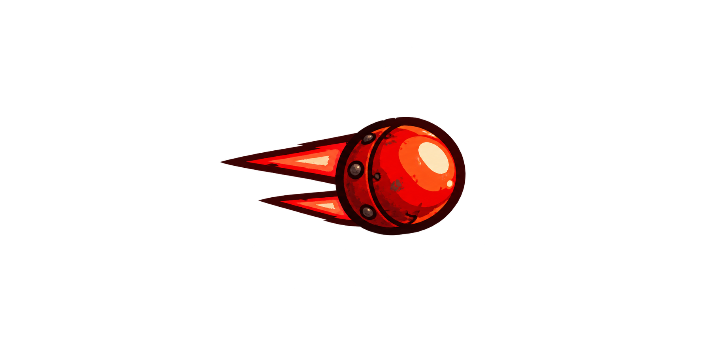

# Disparo do inimigo

## Imagem

## Conceito e função

Projétil vermelho de corpo arredondado, com aro de metal e dois rastros triangulares curtos. Representa perigo e se distingue do disparo do herói tanto pela cor quanto pela silhueta.

Proposta visual criada para manter a linguagem de desenho animado dos anos 1930 e da oficina industrial a vapor.

## Uso previsto no GDevelop

Usar um Sprite separado para os projéteis inimigos. A torreta cria o disparo na saída do canhão; direção, velocidade e intervalos são definidos pelos eventos do ataque. A colisão com o herói aplica o dano conforme suas regras de invulnerabilidade e consome o projétil quando apropriado.

A recomendação é combinar **imagem como Sprite** com **eventos/comportamentos para a lógica**. Não é necessário desenhar o projétil por JavaScript a cada quadro. A extensão Fire Bullet pode auxiliar na emissão e cadência dos disparos.

Para preparar a arte no jogo, ajustar escala e origem, tratar as margens transparentes e definir a máscara de colisão. Nos disparos, a máscara deve representar o corpo relevante do projétil; o rastro decorativo pode ficar fora dela. Validar em movimento que os tiros continuam legíveis sobre a oficina.

Os projéteis precisam ter duração ou limites de percurso para excluir instâncias que já não participam da partida. Como a arena é maior que a tela, a regra de descarte deve considerar esse espaço.

## Arquivos e origem

- [PNG transparente](disparo-inimigo-v1.png)
- [Prompt da geração integrada](PROMPT.md)
- Situação: proposta para avaliação do grupo; arte ainda não configurada no projeto.
- Arte gerada por IA com a ferramenta de imagens integrada ao Codex.
- Referência: composição da partida aprovada.
- [Documentação oficial: disparos com Sprite](https://wiki.gdevelop.io/gdevelop5/tutorials/asteroids/firing_bullet/)
- [Documentação oficial: Fire Bullet](https://wiki.gdevelop.io/gdevelop5/extensions/fire-bullet/details/)

[Voltar ao catálogo](../README.md)
