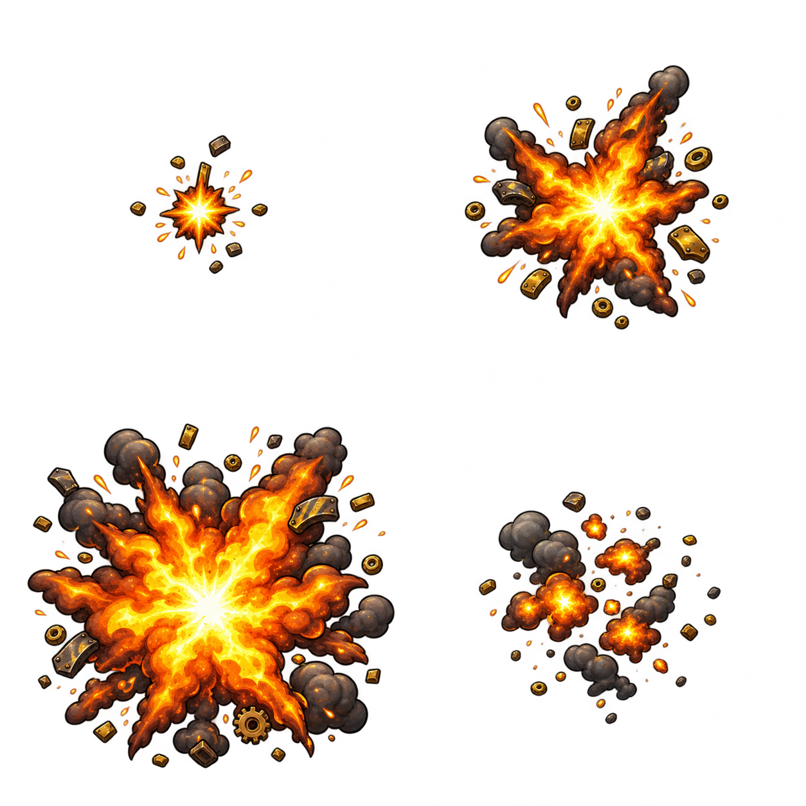

# Explosão — spritesheet v1

Folha de quatro quadros em grade 2 × 2, lidos da esquerda para a direita e de cima para baixo: ignição, expansão, auge e dissipação. A arte usa o mesmo estilo industrial ilustrado dos spritesheets dos inimigos.

- PNG RGBA transparente, 1254 × 1254 px.
- Cada célula mede 627 × 627 px.
- A folha ainda não foi importada no GDevelop. Antes da integração, conferir o recorte, reduzir à escala do jogo e manter o centro da explosão alinhado nos quatro quadros.
- A animação deve tocar uma vez e desaparecer ao terminar.

Criada em 02/11/2026 com a ferramenta de imagens integrada ao Codex. O [prompt](PROMPT.md) registra a geração. A explosão pixel art anterior permanece fora do repositório como estudo descartado.
