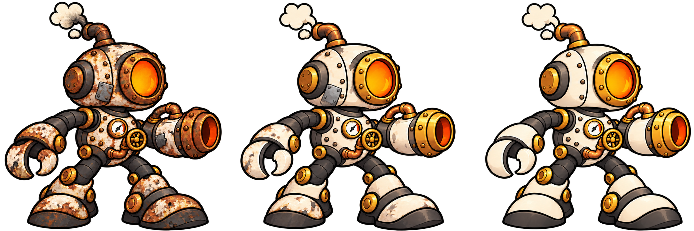

# Evolução do herói — do enferrujado ao restaurado

## O que esta imagem representa

A imagem compara **três estágios do mesmo robô-caldeira**, da esquerda para a direita. Ela traduz a ideia de coletar peças e XP para recuperar uma máquina que começa avariada e termina totalmente revisada.

## Conceito

Evoluir é reconstruir o próprio herói. As peças deixadas pelos inimigos têm uma função narrativa: ajudam a recuperar a carcaça, restaurar componentes e melhorar seu funcionamento. O jogador deve perceber essa transformação durante a partida.

A identidade do robô permanece: cabeça com janela circular de fornalha, escape, manômetro, válvula, pinça, canhão e botas. O que muda é o estado de conservação.

## Os três estágios

| Posição | Estágio | O que deve ser percebido |
| --- | --- | --- |
| Esquerda | **Enferrujado e avariado** | Ferrugem intensa, esmalte gasto, remendos, marcas de uso e escape com fuligem; o robô continua funcional |
| Centro | **Parcialmente restaurado** | Menos ferrugem, peças recuperadas, reparos visíveis e funcionamento mais estável |
| Direita | **Totalmente revisado e polido** | Carcaça íntegra, esmalte limpo, metal e cobre polidos, instrumentos e canhão funcionando |

O estágio final representa a restauração de uma máquina antiga. Sua tecnologia continua sendo movida a vapor.

## Relação com XP e melhorias

A evolução visual acompanha o avanço do personagem durante a partida. A quantidade de XP ou os níveis exatos que liberam cada estágio ainda serão definidos no balanceamento.

- **XP/nível:** representa o progresso e pode liberar a mudança de estágio visual.
- **Melhorias escolhidas:** definem atributos como dano, cadência e vida máxima.
- **Vida atual:** é mostrada na interface e diminui quando o herói recebe dano.

O robô restaurado pode estar com pouca vida em um momento de combate. O desenho representa sua evolução; a barra informa sua condição atual.

## Regras para preparar os sprites

As versões devem manter o mesmo tamanho de corpo, proporção da cabeça, posição de origem, apoio dos pés e área de colisão. Isso permite trocar a aparência durante a partida sem alterar a movimentação nem causar saltos na posição do personagem.

Esta comparação orienta a produção dos três visuais. Para usar no GDevelop, ainda serão necessários arquivos individuais alinhados e o braço-canhão separado, com animações compatíveis entre os estágios.

## Arquivos e origem

- **Situação:** nova proposta visual, criada a pedido do grupo para avaliação.
- **Formato:** PNG com transparência; três estágios na mesma composição.
- [Imagem PNG](heroi-evolucao-tres-estagios-v1.png)
- [Prompts da criação e do refinamento](PROMPT.md)
- Estudo anterior: [imagem](heroi-evolucao-estudo-v1.png) e [prompt](PROMPT-estudo-v1.md)
- Base de identidade: [herói-caldeira aprovado](../heroi/README.md).
- Ferramenta: geração de imagens integrada ao Codex.

[Voltar ao catálogo](../README.md)
