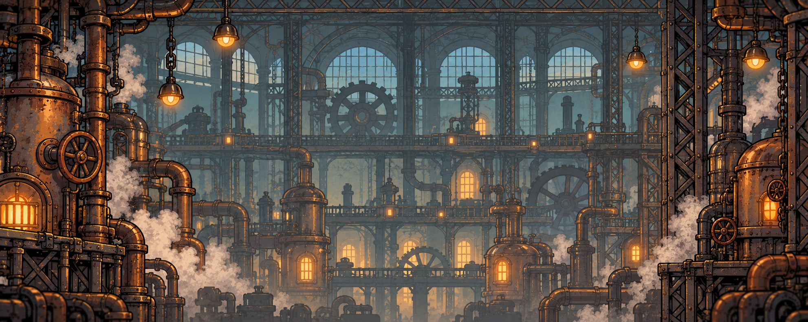

# Fundo da oficina — ambiente industrial a vapor

## O que esta imagem representa

Este panorama mostra o ambiente no qual a partida acontece: uma oficina industrial ampla, com caldeiras, engrenagens, janelas altas, tubulações e estruturas de metal. Ele serve de referência para a paisagem vista atrás dos personagens e das plataformas.

## Conceito

A oficina deve parecer maior que a área visível na tela. O cenário continua para os lados, e a câmera acompanha o robô para revelar outras partes da mesma arena.

O ambiente usa a mesma linguagem do herói: desenho animado dos anos 1930, metal rebitado, cobre, latão, válvulas, instrumentos analógicos, lâmpadas antigas e máquinas movidas a vapor. A iluminação quente das fornalhas contrasta com as estruturas distantes em cinza azulado.

As cores do fundo são mais suaves que as dos personagens, projéteis e peças de XP. Isso ajuda o jogador a reconhecer alvos, perigos e caminhos durante o combate.

## Organização visual

- **Distância:** janelas altas, vigas do telhado e grandes estruturas da fábrica.
- **Profundidade intermediária:** caldeiras, tubulações, passarelas decorativas e engrenagens.
- **Detalhes de atmosfera:** luzes quentes, vapor e desgaste do metal.
- **Área de jogo:** personagens, plataformas, chão e itens serão colocados à frente dessa paisagem como objetos próprios.

As passarelas e máquinas pintadas no fundo são decoração. As superfícies nas quais o robô anda ou pula precisam ter desenho e colisão próprios, com leitura visual distinta.

## Plano de camadas para o parallax

| Camada prevista | Conteúdo | Movimento percebido |
| --- | --- | --- |
| Fundo distante | Janelas, telhado e estruturas ao longe | Deslocamento lento |
| Fundo intermediário | Caldeiras, engrenagens e tubulações | Deslocamento intermediário |
| Espaço de jogo | Chão, plataformas, robô, inimigos e peças | Todos compartilham as posições da arena |
| Interface | Vida, XP, nível e tempo | Permanece fixa na tela |

Ao andar para a direita, a câmera revela o lado direito da oficina; as camadas de fundo deslizam em velocidades diferentes. A arena tem largura delimitada, inicialmente de cerca de 1,5 a 2 telas, a ajustar no protótipo.

## Situação e preparação

- **Situação:** nova proposta de panorama para avaliação.
- **Formato:** PNG opaco e horizontal.
- **Uso atual:** conceito do ambiente e referência de paleta, arquitetura e profundidade.
- **Parallax:** este panorama é uma imagem composta de referência. O [conjunto de camadas](camadas/README.md) oferece duas bordas, um fundo distante e trechos intermediários de máquinas e montagem para experimentar o movimento separado.
- **Continuidade:** as bordas ainda não foram preparadas nem verificadas para repetição horizontal. A extensão do fundo deve cobrir o percurso da câmera definido para a arena.

O conjunto separa o fundo distante, os trechos intermediários de máquinas e montagem e as duas bordas. Chão, plataformas, esteiras e andaimes jogáveis continuam como objetos separados do cenário.

## Arquivos e origem

- [Fábrica em camadas para parallax](camadas/README.md): borda esquerda, borda direita, fundo distante, máquinas intermediárias e linha de montagem.
- [Estudo anterior de moldura em camada única](parallax/README.md): preservado como registro do processo de criação.
- [Imagem PNG](oficina-fundo-conceito-v1.png)
- [Prompt da geração por IA](PROMPT.md)
- Referência: [visão geral do jogo aprovada](../visao-do-jogo/README.md).
- Ferramenta: geração de imagens integrada ao Codex.

[Voltar ao catálogo](../README.md)
