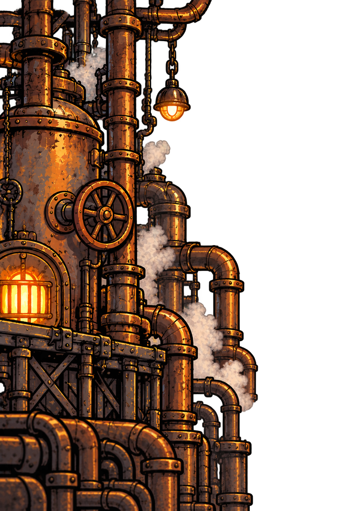
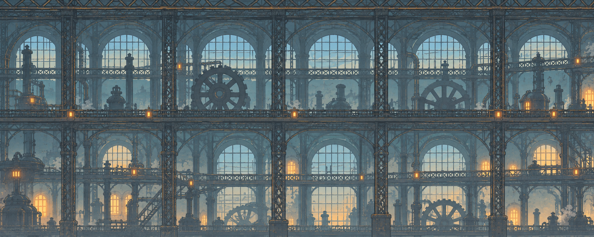
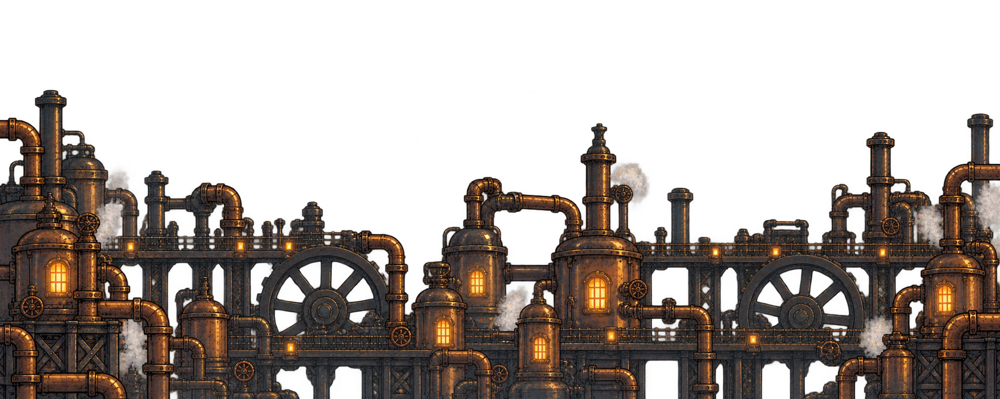
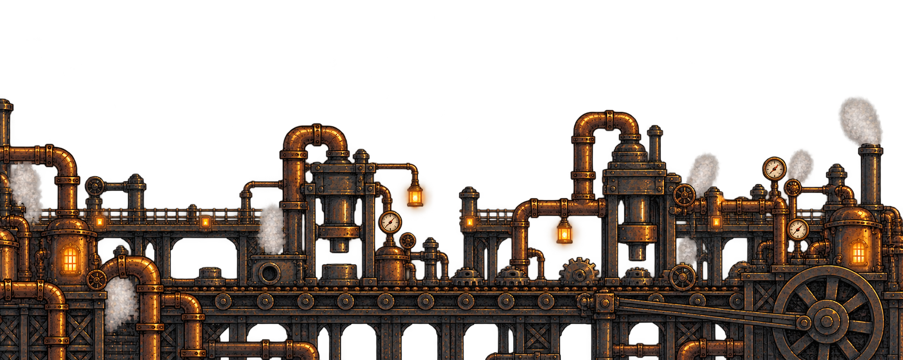

# Fábrica em camadas — cenário e parallax

Este conjunto divide o cenário em **duas bordas independentes, um fundo distante e dois trechos intermediários**: máquinas/tubulações e linha de montagem. O panorama original permanece como referência da direção de arte.

## Peças

| Imagem | Formato | Função |
| --- | --- | --- |
| [Borda esquerda](borda-esquerda/README.md) | Transparente, vertical | Caldeira e tubulações do extremo esquerdo |
| [Borda direita](borda-direita/README.md) | Transparente, vertical | Estrutura metálica e caldeira do extremo direito |
| [Fundo distante](fundo-distante/README.md) | Opaco, panorâmico | Janelas e estruturas distantes da fábrica |
| [Máquinas intermediárias](fundo-maquinas/README.md) | Transparente, panorâmico | Caldeiras, tubos, passarelas e engrenagens à frente das janelas |
| [Linha de montagem](fundo-montagem/README.md) | Transparente, panorâmico | Esteira, prensas e peças em fabricação; continuação lateral do trecho de máquinas |

## Ordem de montagem

1. **Fundo distante:** preenche a tela.
2. **Trechos intermediários:** máquinas e linha de montagem lado a lado, sobre o mesmo fundo distante. As janelas aparecem pelos espaços transparentes; ambos os trechos compartilham a escala e o movimento de parallax.
3. **Bordas esquerda e direita:** nos extremos da arena, com as silhuetas internas voltadas para o centro.
4. **Elementos do jogo:** chão, plataformas, personagens, itens e projéteis, com boa leitura à frente da decoração.
5. **Interface:** fixa na tela.

As bordas são peças do espaço da oficina: aparecem quando a câmera se aproxima de cada extremo. Ajustar a escala para que as duas tenham a mesma altura visual. A transparência permite sobrepô-las aos outros planos.

O panorama original já contém máquinas e bordas pintadas. Para experimentar a composição em peças separadas, usar o fundo distante deste conjunto como base.

## Movimento sugerido

| Plano | Quanto desliza em relação ao deslocamento da câmera |
| --- | --- |
| Fundo distante | Cerca de 20% |
| Máquinas intermediárias | Cerca de 40% |
| Bordas e objetos da arena | 100% |
| Interface | Fixa na tela |

Os valores são um ponto de partida de design para os testes, não uma configuração aplicada ao GDevelop. O deslocamento visual é no sentido contrário ao avanço da câmera. O resultado depende da escala e da extensão da arena.

Dimensionar cada plano para cobrir a tela em todo o percurso; as imagens ainda não foram preparadas para repetição horizontal contínua. O fundo distante e cada um dos dois trechos intermediários têm **1983 × 793 pixels**; as bordas têm **1024 × 1536 pixels**. Conferir o encaixe visual entre as bordas dos painéis ao montar a cena.

## Visualização das peças

### Borda esquerda

### Borda direita

### Fundo distante

### Máquinas intermediárias

### Linha de montagem — continuação lateral

## Organização e origem

Cada subpasta contém o PNG, a explicação de seu conceito e o prompt utilizado. As imagens foram geradas com a ferramenta de imagens integrada ao Codex, usando as referências enviadas e aprovadas pelo grupo. São propostas para avaliação da composição e teste do movimento.

[Voltar ao fundo da oficina](../README.md) · [Voltar ao catálogo de imagens](../../README.md)
