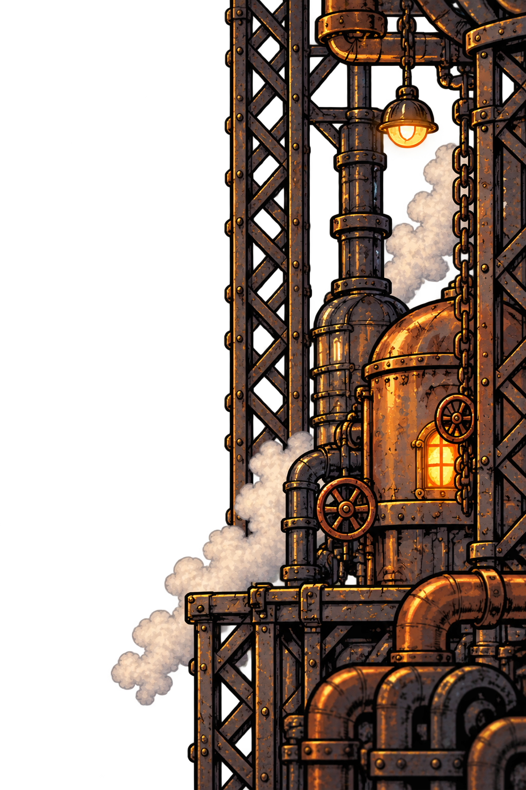

# Borda direita

## Conceito

Conjunto vertical com viga treliçada, caldeira, tubulações, correntes, lâmpada e vapor. Reinterpreta o trecho direito enviado pelo grupo, com transparência ao redor dos elementos.

A linguagem visual segue o cenário aprovado de Oficina em Pane: desenho animado dos anos 1930, ferro rebitado, cobre, válvulas, caldeiras, vapor e iluminação quente de fornalhas.

## Função na composição

Compor o extremo direito da arena. O lado externo fica junto do fim da oficina, com as aberturas e a silhueta irregular voltadas para o centro.

## Movimento previsto

Acompanha o espaço da arena e a câmera. Sua posição é no mundo do jogo, para aparecer quando a câmera se aproxima do extremo direito.

Essas indicações descrevem a intenção visual; os movimentos ainda não foram configurados no projeto. Conferir a escala e a cobertura da imagem durante todo o percurso da câmera.

## Arquivo e preparação

- Formato: **PNG com transparência**.
- Dimensões verificadas: **1024 × 1536 pixels**.
- Situação: nova proposta de camada para avaliar e testar no cenário.
- Uso: decoração de cenário. Colisões, chão e plataformas jogáveis são elementos próprios.
- Bordas horizontais não foram preparadas para repetição contínua. Planejar a largura de cobertura conforme o movimento de cada plano.

## Origem

Arte gerada por IA com a ferramenta de imagens integrada ao Codex. Referências: panorama aprovado da oficina e recorte da respectiva borda enviado pelo usuário.

- [Imagem PNG](borda-direita-v1.png)
- [Prompt da geração integrada](PROMPT.md)
- [Panorama original de referência](../../oficina-fundo-conceito-v1.png)

[Ver montagem das quatro camadas](../README.md)
