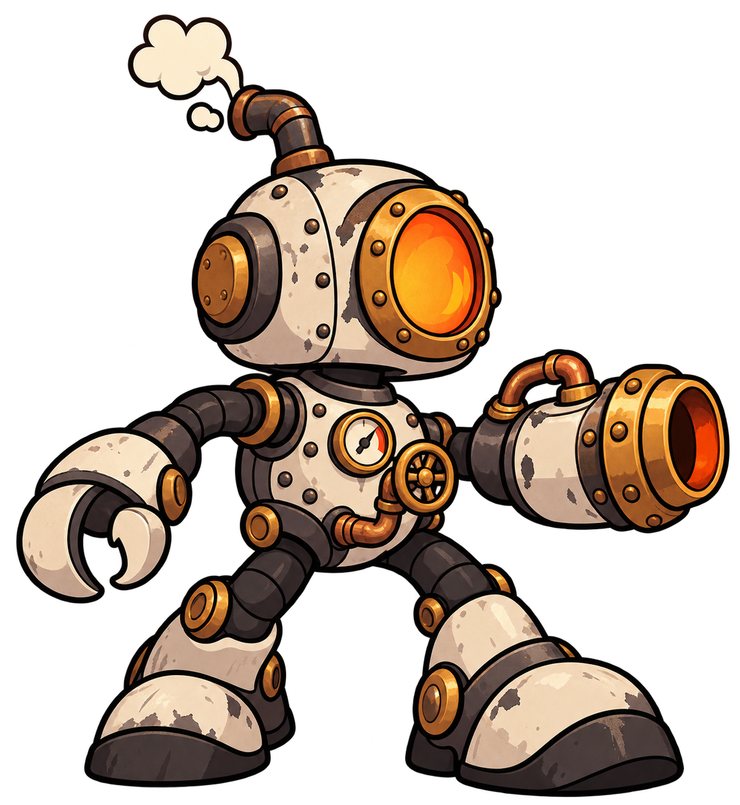

# Herói — robô-caldeira

## O que esta imagem representa

Esta é a referência aprovada para o protagonista de **Oficina em Pane**: um pequeno robô industrial movido a vapor, construído com peças de oficina. Ela define sua identidade e serve de base para os próximos desenhos.

## Conceito

O herói é uma pequena máquina de trabalho que precisa sobreviver à pane da oficina. Sua aparência conecta o personagem ao ambiente: uma fornalha fornece energia, tubulações conduzem pressão, um manômetro mede seu funcionamento e o braço-canhão aproveita essa força para atacar.

A influência dos desenhos dos anos 1930 aparece nas formas arredondadas, nos contornos escuros e na postura expressiva. A tecnologia é mecânica e analógica: metal, vapor e válvulas.

## Elementos que definem o personagem

| Elemento | Identidade visual |
| --- | --- |
| Cabeça | Carcaça arredondada de metal esmaltado e rebitado |
| Janela frontal | Visor circular de fornalha, com brilho laranja e sem rosto |
| Escape | Tubo curvado com uma pequena saída de vapor |
| Peito | Manômetro analógico, válvula e tubulação de cobre |
| Membros | Mangueiras e articulações mecânicas escuras |
| Mãos | Pinça de um lado e canhão pneumático do outro |
| Pés | Botas grandes de metal, que dão peso e estabilidade à silhueta |
| Materiais e cores | Marfim esmaltado, ferro grafite, cobre/latão e laranja da fornalha |

Esses elementos devem permanecer reconhecíveis em todos os estágios de evolução. O desgaste desta ilustração é uma referência de material; a [imagem dos três estágios](../evolucao-heroi/README.md) orienta a diferença entre avariado e restaurado.

## Função no jogo

O jogador controla seus movimentos, pulos, dash, mira e disparos. O personagem deve ser facilmente identificado entre inimigos, peças e efeitos.

A versão usada no jogo precisa manter uma silhueta legível em tamanho pequeno. A mira é livre pelo mouse; por isso, a preparação da arte deve separar o braço-canhão do corpo e definir seu ponto de rotação.

## Situação e preparação

- **Situação:** conceito visual aprovado pelo usuário.
- **Formato:** PNG com fundo transparente.
- **Uso atual:** referência de identidade e materiais.
- **Preparação prevista:** pose lateral consistente, corpo e canhão separados, ponto de apoio dos pés, área de colisão e animações.

Esta ilustração mostra uma pose completa do personagem. Os movimentos de corrida, pulo, dash, tiro e dano ainda serão preparados para o jogo.

## Arquivos e origem

- [Imagem PNG](heroi-caldeira-conceito-v1.png)
- [Prompt e registro da geração por IA](PROMPT.md)
- Referência usada: imagem de robô enviada pelo grupo, como orientação de proporções e linguagem de desenho.
- Ferramenta: geração de imagens integrada ao Codex.

[Voltar ao catálogo](../README.md)
