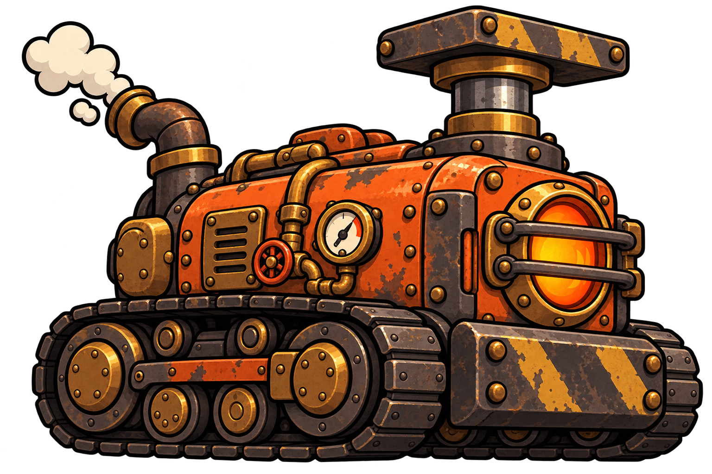
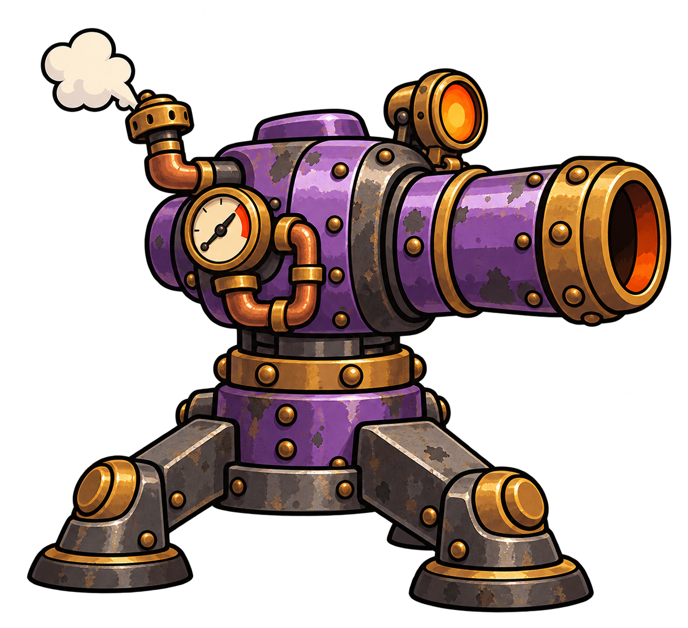

# Oficina em Pane — propostas de inimigos

Material para discussão dos integrantes do grupo. São cinco inimigos comuns e um chefão, com a mesma direção visual do herói: desenho animado dos anos 1930, metal, vapor, rebites e instrumentos analógicos.

As artes são conceitos iniciais gerados por IA com a ferramenta de imagens integrada ao Codex. Ainda serão preparados os sprites e as animações do jogo.

## Andador

**Cor principal:** Cinza / grafite.

**Comportamento:** Persegue o jogador pelo chão e não sobe nas plataformas.

**Conceito:** Um carrinho industrial movido a vapor que perdeu o controle. Seu corpo baixo, as rodas de ferro e o para-choque comunicam deslocamento terrestre e colisão por contato.

**Função no desafio:** Ensina o jogador a usar a altura como proteção e torna a coleta de XP no chão mais arriscada.

## Saltador

**Cor principal:** Verde.

**Comportamento:** Salta para alcançar o jogador quando ele está nas plataformas.

**Conceito:** Uma máquina de mola e pistões que transforma a pressão da caldeira em impulsos verticais. A grande mola é o elemento que define sua função e sua silhueta.

**Função no desafio:** Faz o jogador trocar de posição e impede que as plataformas sejam um abrigo permanente.

## Voador

**Cor principal:** Azul.

**Comportamento:** Voa diretamente até o jogador e atravessa os espaços entre plataformas.

**Conceito:** Uma pequena caldeira esférica suspensa por uma hélice movida a vapor. Seu formato redondo e o rotor separam imediatamente sua leitura da dos inimigos terrestres.

**Função no desafio:** Ameaça o jogador no alto e exige atenção ao espaço aéreo da arena.

## Pesado

**Cor principal:** Laranja.

**Comportamento:** Avança lentamente, resiste a mais dano e faz plataformas tremerem e desabarem quando chega sob elas.

**Conceito:** Uma máquina de prensa e sustentação de cargas que se move sobre esteiras. A estrutura larga e a blindagem transmitem peso; o pistão vertical sugere sua interação com os apoios da oficina.

**Função no desafio:** Obriga o jogador a abandonar uma posição e mudar sua rota quando uma plataforma é ameaçada.

## Atirador

**Cor principal:** Roxo / violeta.

**Comportamento:** Mantém distância do jogador e dispara projéteis.

**Conceito:** Uma torreta pneumática de vigilância da oficina. O pedestal firme, o corpo giratório e o canhão horizontal comunicam sua função de atacar à distância.

**Função no desafio:** Cria linhas de tiro que o jogador precisa evitar ao se mover entre as plataformas.

## Máquina-mãe

**Cor principal:** Vermelho escuro, ferro e latão.

**Comportamento:** É o chefão que aparece no final da partida. Seus ataques e padrões ainda serão definidos.

**Conceito:** O grande núcleo industrial da oficina: uma central de caldeiras e prensas que concentra a energia das máquinas. Sua escala, as três chaminés e os mecanismos laterais criam uma silhueta dominante.

**Função no desafio:** Encerra a progressão da partida e deve exigir a aplicação dos movimentos aprendidos durante as ondas.

## Pontos para discutir

- A função de cada inimigo fica clara pelo formato?
- As cores e silhuetas ajudam a diferenciar os tipos?
- Os desenhos combinam com o robô-caldeira e a oficina?
- Que padrões de ataque a Máquina-mãe deverá ter?

Os detalhes dos ataques da Máquina-mãe continuam em aberto.
