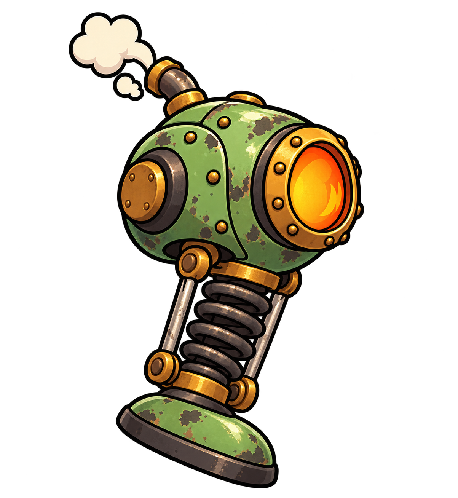

# Inimigos e chefão — Oficina em Pane

Seis propostas visuais para apresentar ao grupo: cinco tipos de inimigo comum e a Máquina-mãe. Cada imagem foi criada individualmente, mantendo a linguagem do robô-caldeira e da oficina aprovada.

Todos usam tecnologia industrial a vapor e formas mecânicas sem rosto humano. Cada inimigo tem cor e silhueta próprias para facilitar sua identificação durante o combate.

## Índice

Para levar ao grupo: [abrir o material de apresentação com as seis imagens](../inimigos-conceitos-v1/LEIA-ME.md) ou [abrir a apresentação resumida](APRESENTACAO.md).

| Inimigo | Identificação | Função |
| --- | --- | --- |
| [Andador](andador/README.md) | Cinza / grafite | Persegue o jogador pelo chão e não sobe nas plataformas. |
| [Saltador](saltador/README.md) | Verde | Salta para alcançar o jogador quando ele está nas plataformas. |
| [Voador](voador/README.md) | Azul | Voa diretamente até o jogador e atravessa os espaços entre plataformas. |
| [Pesado](pesado/README.md) | Laranja | Avança lentamente, resiste a mais dano e faz plataformas tremerem e desabarem quando chega sob elas. |
| [Atirador](atirador/README.md) | Roxo / violeta | Mantém distância do jogador e dispara projéteis. |
| [Máquina-mãe](maquina-mae/README.md) | Vermelho escuro, ferro e latão | É o chefão que aparece no final da partida. Seus ataques e padrões ainda serão definidos. |

## Imagens para apresentação

### Andador

Persegue o jogador pelo chão e não sobe nas plataformas.

[Ver ficha e conceito](andador/README.md) · [Abrir PNG](andador/andador-conceito-v1.png)

### Saltador

Salta para alcançar o jogador quando ele está nas plataformas.

[Ver ficha e conceito](saltador/README.md) · [Abrir PNG](saltador/saltador-conceito-v1.png)

### Voador

Voa diretamente até o jogador e atravessa os espaços entre plataformas.

[Ver ficha e conceito](voador/README.md) · [Abrir PNG](voador/voador-conceito-v1.png)

### Pesado

Avança lentamente, resiste a mais dano e faz plataformas tremerem e desabarem quando chega sob elas.

[Ver ficha e conceito](pesado/README.md) · [Abrir PNG](pesado/pesado-conceito-v1.png)

### Atirador

Mantém distância do jogador e dispara projéteis.

[Ver ficha e conceito](atirador/README.md) · [Abrir PNG](atirador/atirador-conceito-v1.png)

### Máquina-mãe

É o chefão que aparece no final da partida. Seus ataques e padrões ainda serão definidos.

[Ver ficha e conceito](maquina-mae/README.md) · [Abrir PNG](maquina-mae/maquina-mae-conceito-v1.png)

## Como usar na discussão do grupo

Observem se cada silhueta comunica o comportamento, se as cores distinguem os tipos e se todos parecem pertencer à mesma oficina. Para a Máquina-mãe, discutam também a escala desejada e quais mecanismos poderão participar dos padrões de ataque.

Cada pasta contém a imagem, sua ficha em `README.md` e o registro do prompt em `PROMPT.md`. As imagens são conceitos para orientar a produção dos sprites e das animações.

**Origem:** arte conceitual gerada por IA com a ferramenta de imagens integrada ao Codex, a partir das ideias e referências do grupo.

[Voltar ao catálogo de imagens](../README.md) · [Consultar o GDD](../../GDD.md)
