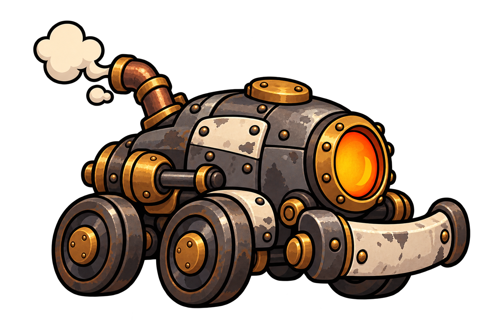

# Andador — conceito de inimigo

## O que esta imagem representa

Persegue o jogador pelo chão e não sobe nas plataformas. Esta é uma proposta visual para apresentar e discutir com os integrantes do grupo.

## Conceito

Um carrinho industrial movido a vapor que perdeu o controle. Seu corpo baixo, as rodas de ferro e o para-choque comunicam deslocamento terrestre e colisão por contato.

O desenho segue a linguagem de **Oficina em Pane**: animação dos anos 1930, metal rebitado, vapor, cobre, latão e instrumentos analógicos. A identificação de cor principal é **cinza / grafite**.

## Elementos visuais

- Carcaça baixa de ferro cinza, com painéis esmaltados gastos e rebites.
- Rodas e eixo aparentes, com formato compacto e estável.
- Janela circular de fornalha, escape curvado e para-choque frontal.

## Função na partida

Ensina o jogador a usar a altura como proteção e torna a coleta de XP no chão mais arriscada.

## Preparação para o jogo

Giro das rodas, leve balanço da carcaça, vapor do escape e reação ao receber dano.

A imagem é uma ilustração conceitual completa, em PNG com transparência. Para montar a versão animada, ainda serão definidos os recortes de peças, os pontos de origem e as áreas de colisão. A aparência poderá ser ajustada após a discussão do grupo.

## Arquivos e origem

- [Imagem PNG](andador-conceito-v1.png)
- [Prompt utilizado](PROMPT.md)
- **Situação:** proposta inicial para avaliação do grupo.
- **Origem:** imagem gerada por IA com a ferramenta de imagens integrada ao Codex.
- **Referências de estilo:** [herói aprovado](../../heroi/README.md) e [visão da partida aprovada](../../visao-do-jogo/README.md).

[Voltar à galeria de inimigos](../README.md) · [Voltar ao catálogo de imagens](../../README.md)
