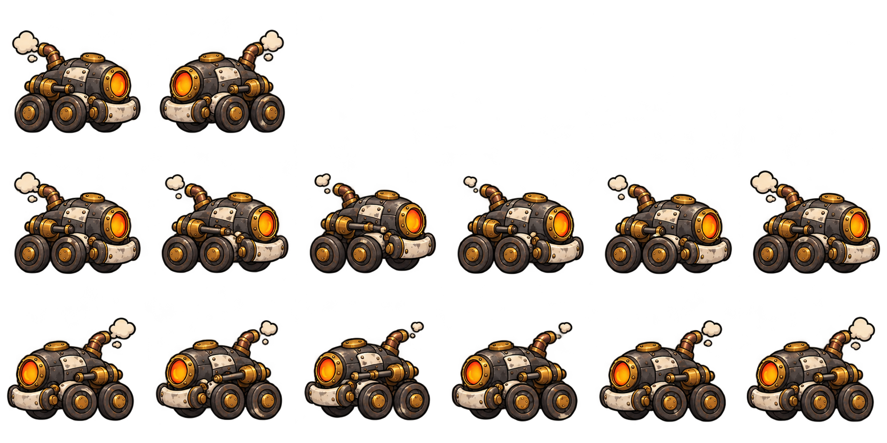

# Andador — spritesheet v1

## Organização

Primeiro inimigo da produção de spritesheets, usando o conceito do carrinho a vapor como referência. O Andador se locomove com rodas; seu ciclo de movimento combina variações nas rodas, no mecanismo lateral e no vapor.

| Linha | Colunas | Conteúdo |
| --- | --- | --- |
| 1 | 1 e 2 | Parado para a direita e parado para a esquerda |
| 1 | 3 a 6 | Transparentes, sem quadros |
| 2 | 1 a 6 | Seis quadros de movimento para a direita |
| 3 | 1 a 6 | Seis quadros de movimento para a esquerda |

São **14 quadros utilizados**, organizados numa grade de seis colunas e três linhas. A sequência de movimento volta do quadro 6 ao quadro 1. Ponto de partida para avaliação: **8 quadros por segundo**.

## Arquivo e importação

- PNG RGBA com transparência verificada.
- Tamanho efetivamente gerado: **1774 × 887 px**.
- A organização visual de duas poses paradas e dois ciclos de seis quadros foi conferida.
- As quatro células vazias da primeira linha não contêm figuras opacas; a medição detectou apenas resíduo de alfa de até 1/255 nessas áreas.
- O tamanho solicitado no prompt foi 1536 × 768 px; a ferramenta produziu outra resolução.
- As dimensões reais não são divisíveis exatamente pela grade 6 × 3. Os recortes arredondados ficam com 295 ou 296 px por lado.
- [quadros.json](quadros.json) registra os 14 retângulos e os limites visíveis medidos em cada célula.

O `quadros.json` é um mapa auxiliar para a preparação da arte: indica onde começa e termina cada quadro e a qual animação ele pertence. Ele não está sendo carregado pelo jogo e não é necessário para executar o projeto. Pode apoiar o recorte e o alinhamento dos sprites; não aplica essas correções ao PNG sozinho.

Antes da importação definitiva, uniformizar os quadros num canvas comum de **296 × 296 px** e alinhar a origem na base das rodas. A linha parada está mais baixa na célula original do que os ciclos em movimento. Importar tudo com uma origem idêntica sem corrigir essa diferença causaria um pequeno salto na troca de animação.

A continuidade das rodas e do pistão e a aparência final devem ser avaliadas pelo grupo. A folha ainda não foi integrada ao projeto GDevelop. As prévias locais de avaliação ficam fora do repositório.

## Arquivos e origem

- [PNG](andador-spritesheet-v1.png)
- [Retângulos e medidas dos quadros](quadros.json)
- [Prompt completo](PROMPT.md)
- [Conceito de referência](../andador-conceito-v1.png)

Gerado em 02/11/2026 com a ferramenta de imagens integrada ao Codex. O conceito original foi preservado.

[Voltar à ficha do Andador](../README.md) · [Galeria de inimigos](../../README.md)
