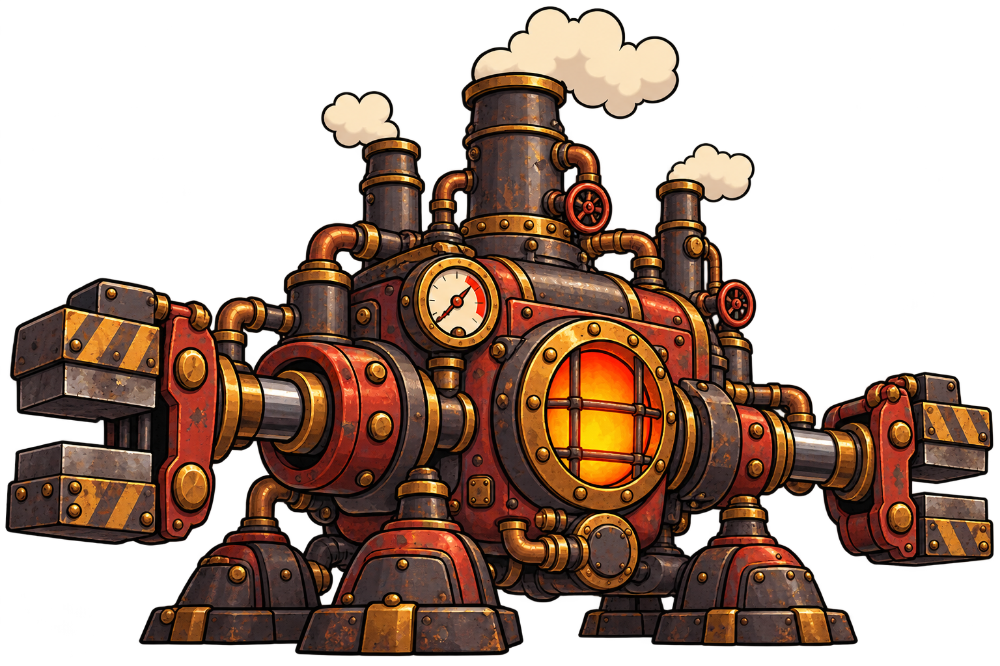

# Máquina-mãe — conceito de inimigo

## O que esta imagem representa

É o chefão que aparece no final da partida. Seus ataques e padrões ainda serão definidos. Esta é uma proposta visual para apresentar e discutir com os integrantes do grupo.

## Conceito

O grande núcleo industrial da oficina: uma central de caldeiras e prensas que concentra a energia das máquinas. Sua escala, as três chaminés e os mecanismos laterais criam uma silhueta dominante.

O desenho segue a linguagem de **Oficina em Pane**: animação dos anos 1930, metal rebitado, vapor, cobre, latão e instrumentos analógicos. A identificação de cor principal é **vermelho escuro, ferro e latão**.

## Elementos visuais

- Grande estrutura central vermelha e grafite, com fornalha circular protegida por barras.
- Três torres de caldeira/escape, tubulações grossas, válvulas e manômetro.
- Prensas/pinças industriais laterais acionadas por pistões e bases pesadas de sustentação.

## Função na partida

Encerra a progressão da partida e deve exigir a aplicação dos movimentos aprendidos durante as ondas.

## Preparação para o jogo

Vapor das chaminés, vibração da caldeira, manômetro e movimento das prensas. Esses mecanismos oferecem possibilidades visuais; os ataques, a área vulnerável e as fases de combate continuam em aberto.

A imagem é uma ilustração conceitual completa, em PNG com transparência. Para montar a versão animada, ainda serão definidos os recortes de peças, os pontos de origem e as áreas de colisão. A aparência poderá ser ajustada após a discussão do grupo.

## Arquivos e origem

- [Imagem PNG](maquina-mae-conceito-v1.png)
- [Prompt utilizado](PROMPT.md)
- **Situação:** proposta inicial para avaliação do grupo.
- **Origem:** imagem gerada por IA com a ferramenta de imagens integrada ao Codex.
- **Referências de estilo:** [herói aprovado](../../heroi/README.md) e [visão da partida aprovada](../../visao-do-jogo/README.md).

[Voltar à galeria de inimigos](../README.md) · [Voltar ao catálogo de imagens](../../README.md)
