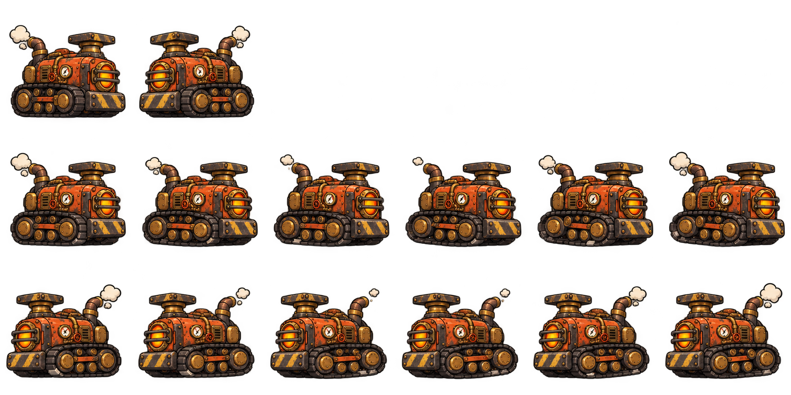

# Pesado — spritesheet v1

## Organização

O ciclo mostra variações nas esteiras, nos roletes e no vapor, com vibração discreta da carcaça. A prensa superior permanece recolhida durante o deslocamento. O acionamento da prensa não faz parte desta folha.

| Linha | Colunas | Conteúdo |
| --- | --- | --- |
| 1 | 1 e 2 | Parado para a direita e parado para a esquerda |
| 1 | 3 a 6 | Sem sprites |
| 2 | 1 a 6 | Seis quadros de deslocamento sobre esteiras para a direita |
| 3 | 1 a 6 | Seis quadros de deslocamento sobre esteiras para a esquerda |

A folha contém **14 quadros utilizados**. Cada ciclo de movimento percorre as seis colunas e volta ao primeiro quadro. Velocidade inicial sugerida para avaliar o ciclo: **6 quadros por segundo**, a ajustar no jogo.

## Arquivo e medidas

- PNG RGBA com transparência, conferido.
- Dimensões efetivamente geradas: **1774 × 887 px**.
- Organização visual conferida: duas poses paradas e dois ciclos de seis quadros.
- As quatro células sem sprites não contêm figuras opacas. O alfa residual máximo medido nessas células é 1/255.
- [quadros.json](quadros.json) registra as coordenadas, os tamanhos e os limites visíveis de cada quadro.
- A resolução não é divisível exatamente pela grade 6 × 3. Os retângulos arredondados têm pequenas diferenças de tamanho; a exportação para uso definitivo precisa de um canvas uniforme de 296 × 296 px.

O JSON é um mapa auxiliar de preparação. Ele não é carregado pelo jogo e não recorta, normaliza ou altera o PNG automaticamente.

## Alinhamento e integração

Usar a base das esteiras como linha de apoio e manter o mesmo ponto de origem entre poses paradas e deslocamento. A prensa não deve alterar a caixa de colisão durante este ciclo.

Os quadros ainda precisam de preparação para a escala final e conferência dos pontos de origem antes da importação definitiva no GDevelop. Os desenhos dos ciclos não foram transformados em arquivos individuais nem adicionados às animações do protótipo.

## Avaliação

O spritesheet é uma proposta de animação para avaliação do grupo. Conferir a continuidade do ciclo, a consistência do corpo entre os quadros e a leitura em tamanho de jogo.

As prévias HTML ficam em uma pasta local **fora do repositório**. A prévia alinha a base visível dos recortes a uma linha de apoio; isso não normaliza os quadros no PNG. A visualização não modifica os pixels da folha original.

## Arquivos e origem

- [PNG](pesado-spritesheet-v1.png)
- [Mapa de quadros](quadros.json)
- [Prompt completo](PROMPT.md)
- [Conceito utilizado como referência](../pesado-conceito-v1.png)

Gerado em 02/11/2026 pela ferramenta de imagens integrada ao Codex. A identidade visual do inimigo usa o conceito já registrado; a organização segue o spritesheet aprovado do Andador.

[Voltar à ficha do inimigo](../README.md) · [Galeria de inimigos](../../README.md)
