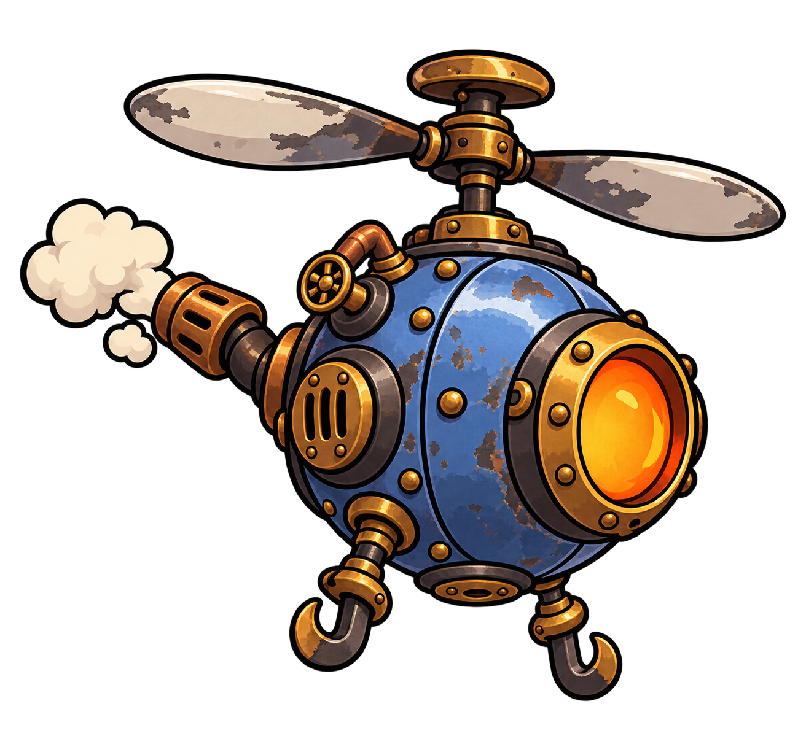

# Voador — conceito de inimigo

## O que esta imagem representa

Voa diretamente até o jogador e atravessa os espaços entre plataformas. Esta é uma proposta visual para apresentar e discutir com os integrantes do grupo.

## Conceito

Uma pequena caldeira esférica suspensa por uma hélice movida a vapor. Seu formato redondo e o rotor separam imediatamente sua leitura da dos inimigos terrestres.

O desenho segue a linguagem de **Oficina em Pane**: animação dos anos 1930, metal rebitado, vapor, cobre, latão e instrumentos analógicos. A identificação de cor principal é **azul**.

## Elementos visuais

- Carcaça esférica azul com rebites, válvula e tubulações de cobre.
- Hélice grande no topo e escape lateral/traseiro com vapor.
- Janela circular quente e pequenos ganchos estabilizadores na parte inferior.

## Função na partida

Ameaça o jogador no alto e exige atenção ao espaço aéreo da arena.

## Preparação para o jogo

Rotação da hélice, oscilação curta durante o voo, vapor e reação ao impacto.

A imagem é uma ilustração conceitual completa, em PNG com transparência. Para montar a versão animada, ainda serão definidos os recortes de peças, os pontos de origem e as áreas de colisão. A aparência poderá ser ajustada após a discussão do grupo.

## Arquivos e origem

- [Imagem PNG](voador-conceito-v1.png)
- [Prompt utilizado](PROMPT.md)
- **Situação:** proposta inicial para avaliação do grupo.
- **Origem:** imagem gerada por IA com a ferramenta de imagens integrada ao Codex.
- **Referências de estilo:** [herói aprovado](../../heroi/README.md) e [visão da partida aprovada](../../visao-do-jogo/README.md).

[Voltar à galeria de inimigos](../README.md) · [Voltar ao catálogo de imagens](../../README.md)
