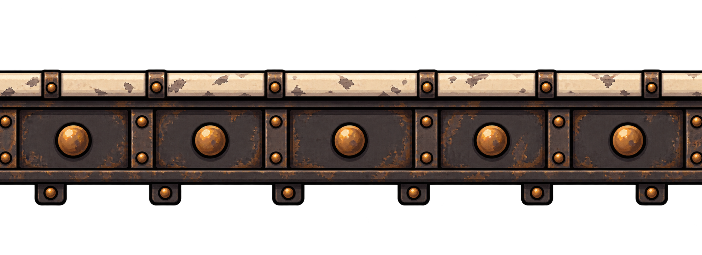
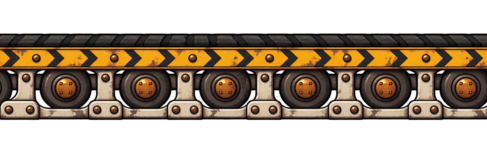
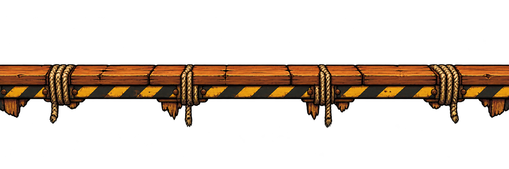
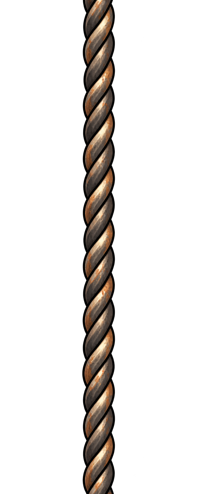
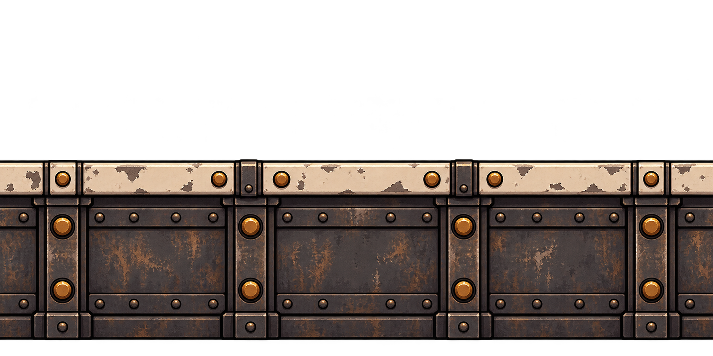
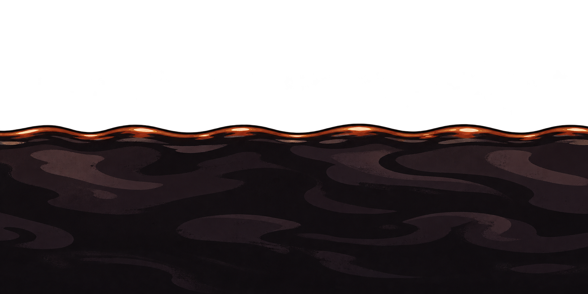

# Plataformas e elementos da arena — Oficina em Pane

Seis artes-base para a arena, seguindo a oficina a vapor e o desenho dos anos 1930. Cada tipo tem materiais e cores próprios para facilitar a leitura durante o combate.

A solução escolhida é o **trecho repetível**, compatível com os objetos Tiled Sprite que o protótipo já usa. Esta versão contém trechos centrais contínuos; acabamentos separados de ponta esquerda e direita não fazem parte do conjunto.

## Arquivos

| Elemento | Repetição prevista | PNG original (px) |
| --- | --- | --- |
| [Prateleira de ferro](prateleira/README.md) | Horizontal | 2079 × 756 |
| [Esteira transportadora](esteira/README.md) | Horizontal | 2172 × 724 |
| [Andaime de madeira](andaime/README.md) | Horizontal | 2172 × 724 |
| [Cabo de sustentação](fio/README.md) | Vertical | 793 × 1983 |
| [Chão da fábrica](chao/README.md) | Horizontal | 1774 × 887 |
| [Óleo perigoso](oleo/README.md) | Horizontal | 1774 × 887 |

Todos os PNGs têm canal alfa com transparência real. Cada pasta contém uma imagem, um README e o prompt completo da geração integrada.

## Situação e preparação

Estas são **artes-base para avaliação e preparação**, em alta resolução. A geração incluiu margens transparentes e pequenas variações nas bordas: elas precisam ser recortadas, reduzidas e conferidas antes de substituir as texturas do protótipo. Não são arquivos finais de 16 px de altura, e a emenda exata entre cópias ainda não foi testada no GDevelop.

O [guia de preparação](PREPARACAO.md) registra os recortes medidos, as alturas atuais e os cuidados com apoio, repetição e sentido da esteira. As [medidas em JSON](MEDIDAS.json) permitem reaproveitar esses dados.

No GDevelop, [Tiled Sprite](https://wiki.gdevelop.io/gdevelop5/objects/tiled_sprite/) repete a imagem ao aumentar a área do objeto. Para uma versão futura com acabamentos nas pontas, [Panel Sprite](https://wiki.gdevelop.io/gdevelop5/objects/panel_sprite/) permite definir margens e repetir o centro e as bordas. O conjunto atual segue a primeira opção.

## Prateleira de ferro

[Conceito e uso](prateleira/README.md) · [Prompt](prateleira/PROMPT.md)

## Esteira transportadora

[Conceito e uso](esteira/README.md) · [Prompt](esteira/PROMPT.md)

## Andaime de madeira

[Conceito e uso](andaime/README.md) · [Prompt](andaime/PROMPT.md)

## Cabo de sustentação

[Conceito e uso](fio/README.md) · [Prompt](fio/PROMPT.md)

## Chão da fábrica

[Conceito e uso](chao/README.md) · [Prompt](chao/PROMPT.md)

## Óleo perigoso

[Conceito e uso](oleo/README.md) · [Prompt](oleo/PROMPT.md)

## Origem

Geradas em 02/11/2026 com a ferramenta de imagens integrada ao Codex, usando o herói e o cenário aprovados como referências de materiais e linguagem visual. As plataformas têm uma borda de apoio mais clara para se destacar do fundo.

[Voltar ao catálogo de imagens](../README.md)
