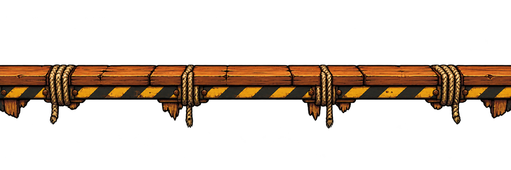

# Andaime de madeira

## Conceito

Tábuas envelhecidas em tons de madeira alaranjada, amarrações de corda, rachaduras frontais e faixa de alerta amarela e preta. A silhueta inferior irregular sugere fragilidade.

## Uso previsto

Repetição horizontal. As lascas e pontas de corda ficam abaixo do apoio. Tremor, queda e retorno do andaime são controlados pela lógica do jogo.

A arte sugere risco de desabamento sem criar buracos no apoio. As amarrações exigem conferência do alinhamento do topo na escala final.

## Arquivo-base e preparação

- PNG RGBA com transparência verificada; 2172 × 724 px.
- Arte original em alta resolução; ainda precisa de recorte e redução para a escala do protótipo.
- Recorte inicial sugerido: x = 0, y = 278, largura = 2172, altura = 269 px.
- Redução inicial sugerida após o recorte: 129 × 16 px, preservando aproximadamente a proporção.
- Direção de repetição: horizontal.
- A repetição foi solicitada na geração, mas as bordas não foram corrigidas nem validadas como uma emenda exata no GDevelop.

Conferir o resultado na escala final. Os valores são um ponto de partida medido no PNG, não um recorte já aplicado. Veja o [guia de preparação](../PREPARACAO.md).

## Origem

Arte gerada em 02/11/2026 com a ferramenta de geração de imagens integrada ao Codex. Referências de estilo: [robô-caldeira](../../heroi/README.md) e [máquinas da oficina](../../fundo-oficina/camadas/fundo-maquinas/README.md). Os PNGs originais foram preservados.

- [Imagem PNG](andaime-repetivel-v1.png)
- [Prompt completo](PROMPT.md)
- [Galeria de plataformas](../README.md)
