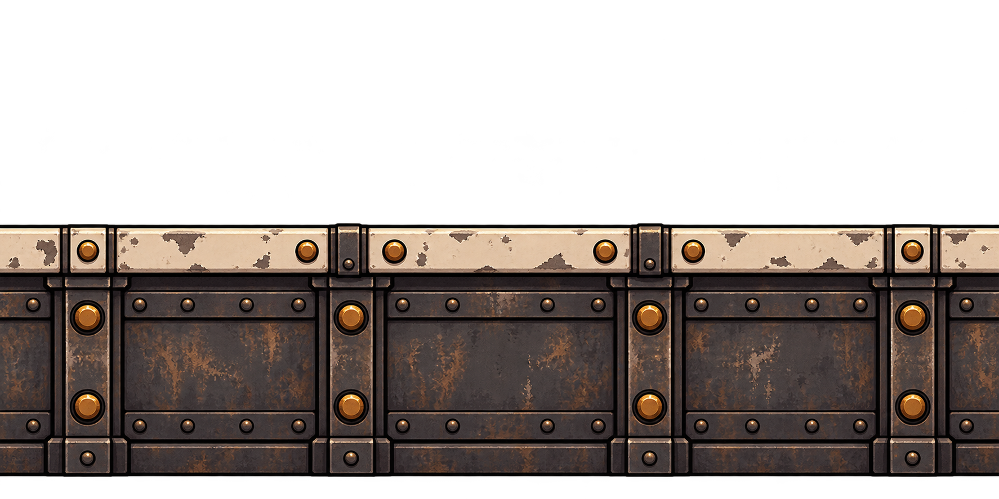

# Chão da fábrica

## Conceito

Base espessa de placas de ferro rebitadas, com um acabamento superior claro que delimita o piso. A massa de metal escuro diferencia o chão das plataformas mais finas.

## Uso previsto

Repetição horizontal para cobrir a largura da arena. O protótipo usa Chao com 2560 × 32 px e comportamento de plataforma normal.

A parte superior precisa coincidir com a linha de colisão. As placas são vistas de frente, sem depender de uma superfície em perspectiva.

## Arquivo-base e preparação

- PNG RGBA com transparência verificada; 1774 × 887 px.
- Arte original em alta resolução; ainda precisa de recorte e redução para a escala do protótipo.
- Recorte inicial sugerido: x = 0, y = 400, largura = 1774, altura = 448 px.
- Redução inicial sugerida após o recorte: 127 × 32 px, preservando aproximadamente a proporção.
- Direção de repetição: horizontal.
- A repetição foi solicitada na geração, mas as bordas não foram corrigidas nem validadas como uma emenda exata no GDevelop.

Conferir o resultado na escala final. Os valores são um ponto de partida medido no PNG, não um recorte já aplicado. Veja o [guia de preparação](../PREPARACAO.md).

## Origem

Arte gerada em 02/11/2026 com a ferramenta de geração de imagens integrada ao Codex. Referências de estilo: [robô-caldeira](../../heroi/README.md) e [máquinas da oficina](../../fundo-oficina/camadas/fundo-maquinas/README.md). Os PNGs originais foram preservados.

- [Imagem PNG](chao-repetivel-v1.png)
- [Prompt completo](PROMPT.md)
- [Galeria de plataformas](../README.md)
