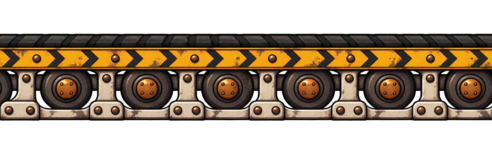

# Esteira transportadora

## Conceito

Correia escura, roletes com centros de cobre e uma faixa amarela com setas para a direita. A indicação de movimento aparece na face frontal, abaixo da superfície de apoio.

## Uso previsto

Repetição horizontal. As setas desta versão apontam para a direita. A arte é estática: deslocamento da correia e efeito sobre o jogador dependem dos eventos.

No protótipo, existem esteiras com Velocidade = -180. Essas instâncias precisam de uma versão visual espelhada para a esquerda durante a preparação; o sentido pintado deve corresponder ao movimento. Não basta inverter somente a velocidade mantendo as setas para a direita.

## Arquivo-base e preparação

- PNG RGBA com transparência verificada; 2172 × 724 px.
- Arte original em alta resolução; ainda precisa de recorte e redução para a escala do protótipo.
- Recorte inicial sugerido: x = 0, y = 151, largura = 2172, altura = 385 px.
- Redução inicial sugerida após o recorte: 90 × 16 px, preservando aproximadamente a proporção.
- Direção de repetição: horizontal.
- A repetição foi solicitada na geração, mas as bordas não foram corrigidas nem validadas como uma emenda exata no GDevelop.

Conferir o resultado na escala final. Os valores são um ponto de partida medido no PNG, não um recorte já aplicado. Veja o [guia de preparação](../PREPARACAO.md).

## Origem

Arte gerada em 02/11/2026 com a ferramenta de geração de imagens integrada ao Codex. Referências de estilo: [robô-caldeira](../../heroi/README.md) e [máquinas da oficina](../../fundo-oficina/camadas/fundo-maquinas/README.md). Os PNGs originais foram preservados.

- [Imagem PNG](esteira-direita-repetivel-v1.png)
- [Prompt completo](PROMPT.md)
- [Galeria de plataformas](../README.md)
