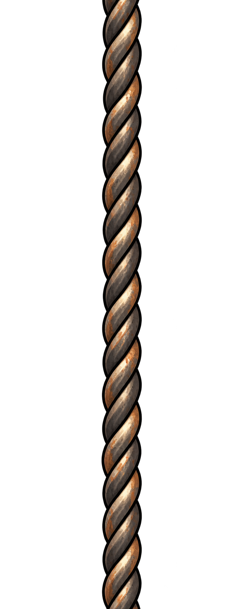

# Cabo de sustentação

## Conceito

Cabo de aço trançado com contorno escuro, reflexos claros e desgaste em tons de cobre. Faz a ligação visual entre a estrutura alta da oficina e as plataformas suspensas.

## Uso previsto

Repetição vertical. Deve manter a mesma espessura ao mudar a altura. O protótipo usa Fio com 4 px de largura; é um elemento decorativo, sem comportamento Platform.

Remover as grandes margens laterais antes de exportar uma textura estreita. Conferir a continuidade do trançado entre o fim e o início da repetição.

## Arquivo-base e preparação

- PNG RGBA com transparência verificada; 793 × 1983 px.
- Arte original em alta resolução; ainda precisa de recorte e redução para a escala do protótipo.
- Recorte inicial sugerido: x = 330, y = 0, largura = 134, altura = 1983 px.
- Redução inicial sugerida após o recorte: 4 × 59 px, preservando aproximadamente a proporção.
- Direção de repetição: vertical.
- A repetição foi solicitada na geração, mas as bordas não foram corrigidas nem validadas como uma emenda exata no GDevelop.

Conferir o resultado na escala final. Os valores são um ponto de partida medido no PNG, não um recorte já aplicado. Veja o [guia de preparação](../PREPARACAO.md).

## Origem

Arte gerada em 02/11/2026 com a ferramenta de geração de imagens integrada ao Codex. Referências de estilo: [robô-caldeira](../../heroi/README.md) e [máquinas da oficina](../../fundo-oficina/camadas/fundo-maquinas/README.md). Os PNGs originais foram preservados.

- [Imagem PNG](cabo-vertical-repetivel-v1.png)
- [Prompt completo](PROMPT.md)
- [Galeria de plataformas](../README.md)
