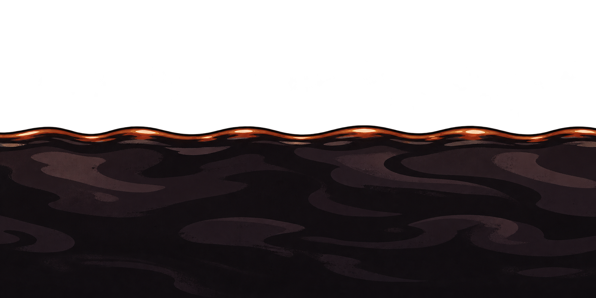

# Óleo perigoso

## Conceito

Líquido quase preto com reflexos em ameixa e uma borda iluminada em vermelho acobreado. A cor quente na superfície ajuda a reconhecer o perigo contra o cenário frio.

## Uso previsto

Repetição horizontal. O protótipo usa Oleo com 2560 × 120 px. O óleo é uma zona de perigo; não recebe comportamento de plataforma.

A superfície é ondulada por ser um líquido. Se a altura do óleo variar, manter a superfície somente no topo e ampliar o corpo abaixo dela; repetir a textura também na vertical faria aparecer outras superfícies dentro do líquido. A subida e o dano dependem dos eventos.

## Arquivo-base e preparação

- PNG RGBA com transparência verificada; 1774 × 887 px.
- Arte original em alta resolução; ainda precisa de recorte e redução para a escala do protótipo.
- Recorte inicial sugerido: x = 0, y = 373, largura = 1774, altura = 514 px.
- Redução inicial sugerida após o recorte: 414 × 120 px, preservando aproximadamente a proporção.
- Direção de repetição: horizontal.
- A repetição foi solicitada na geração, mas as bordas não foram corrigidas nem validadas como uma emenda exata no GDevelop.

Conferir o resultado na escala final. Os valores são um ponto de partida medido no PNG, não um recorte já aplicado. Veja o [guia de preparação](../PREPARACAO.md).

## Origem

Arte gerada em 02/11/2026 com a ferramenta de geração de imagens integrada ao Codex. Referências de estilo: [robô-caldeira](../../heroi/README.md) e [máquinas da oficina](../../fundo-oficina/camadas/fundo-maquinas/README.md). Os PNGs originais foram preservados.

- [Imagem PNG](oleo-superficie-repetivel-v1.png)
- [Prompt completo](PROMPT.md)
- [Galeria de plataformas](../README.md)
