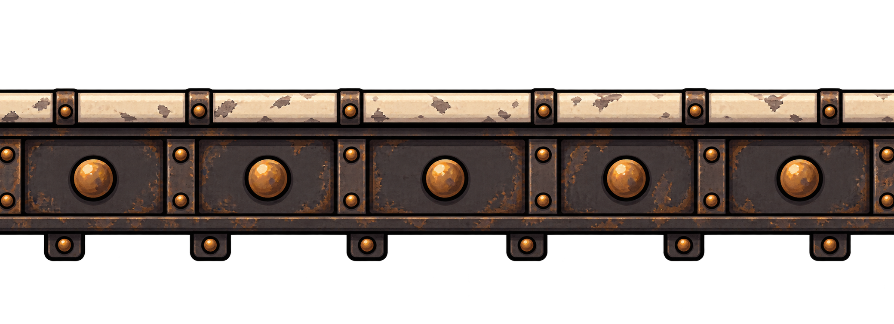

# Prateleira de ferro

## Conceito

Plataforma firme com borda de esmalte marfim, viga de ferro escuro e rebites de cobre. A faixa clara destaca a superfície de apoio contra as máquinas do fundo.

## Uso previsto

Repetição horizontal do trecho central. É uma arte para a plataforma atravessável por baixo; o comportamento de colisão pertence ao objeto do jogo.

As pequenas abas inferiores são decoração. A linha de apoio deve coincidir com o topo da faixa clara após o recorte.

## Arquivo-base e preparação

- PNG RGBA com transparência verificada; 2079 × 756 px.
- Arte original em alta resolução; ainda precisa de recorte e redução para a escala do protótipo.
- Recorte inicial sugerido: x = 0, y = 209, largura = 2079, altura = 400 px.
- Redução inicial sugerida após o recorte: 83 × 16 px, preservando aproximadamente a proporção.
- Direção de repetição: horizontal.
- A repetição foi solicitada na geração, mas as bordas não foram corrigidas nem validadas como uma emenda exata no GDevelop.

Conferir o resultado na escala final. Os valores são um ponto de partida medido no PNG, não um recorte já aplicado. Veja o [guia de preparação](../PREPARACAO.md).

## Origem

Arte gerada em 02/11/2026 com a ferramenta de geração de imagens integrada ao Codex. Referências de estilo: [robô-caldeira](../../heroi/README.md) e [máquinas da oficina](../../fundo-oficina/camadas/fundo-maquinas/README.md). Os PNGs originais foram preservados.

- [Imagem PNG](prateleira-repetivel-v1.png)
- [Prompt completo](PROMPT.md)
- [Galeria de plataformas](../README.md)
