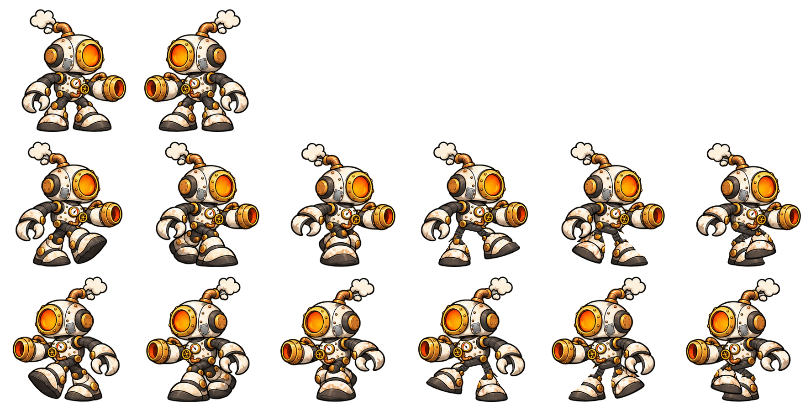

# Herói — Parcialmente restaurado — v2

## Aparência

Menos ferrugem e sujeira, cobre recuperado e esmalte em melhor estado; ainda há desgaste e o remendo da cabeça.

A identidade continua sendo a do robô-caldeira: janela circular de fornalha, escape, manômetro, pinça, canhão pneumático e botas de metal.

## Organização

- Linha 1: parado para a direita na coluna 1 e para a esquerda na coluna 2; as outras quatro células ficam transparentes.
- Linha 2: seis quadros andando para a direita.
- Linha 3: seis quadros andando para a esquerda.

São **14 quadros utilizados**, com o ciclo completo alternando as pernas. A segunda metade foi recomposta por partes para manter cada perna ligada ao seu próprio quadril.

| Quadro | Passada |
| --- | --- |
| 1 | Direita avança; esquerda apoia |
| 2 | Direita apoia; esquerda recupera |
| 3 | Direita apoia; esquerda passa |
| 4 | Esquerda avança; direita apoia |
| 5 | Esquerda apoia; direita recupera |
| 6 | Esquerda apoia; direita passa para o próximo passo |

## Medidas e preparação

- Folha: **1776 × 888 px**, PNG RGBA.
- Grade exata: **6 colunas × 3 linhas**, com células de **296 × 296 px**.
- Origem comum sugerida, na base dos pés: **x = 148, y = 289**, relativa à célula.
- Os quatro espaços sem personagens estão totalmente transparentes.
- Os quadros já foram alinhados à mesma linha de apoio; não é necessário corrigir células de 295/296 px como na versão anterior.
- [quadros.json](quadros.json) registra cada recorte, a origem e a fase da passada.

O JSON é um mapa auxiliar e não é carregado pelo jogo. Para trocar de estágio, usar a mesma escala, origem e caixa de colisão. A aparência representa evolução por XP, independentemente da vida atual.

O personagem aparece completo. A separação do braço-canhão e seu ponto de rotação para a mira livre continuam sendo uma etapa própria da integração ao GDevelop.

## Origem da revisão

Arte inicial gerada por IA. Em **03/11/2026**, a revisão v2 foi montada com **Python/Pillow, com autorização do usuário**: recorte das peças, posicionamento independente das pernas, reconstrução das conexões mecânicas, limpeza da transparência e normalização da grade. A direção esquerda é o espelhamento da direita.

A prévia HTML com controles de avanço e retorno de quadro fica fora do repositório. As folhas anteriores ficam no material local de estudo.

- [PNG corrigido](heroi-intermediario-spritesheet-v2.png)
- [Mapa de quadros](quadros.json)
- [Prompts e registro da montagem](PROMPT.md)
- [Conjunto dos três estágios](../README.md)
- [Referência de evolução](../../../../evolucao-heroi/README.md)
