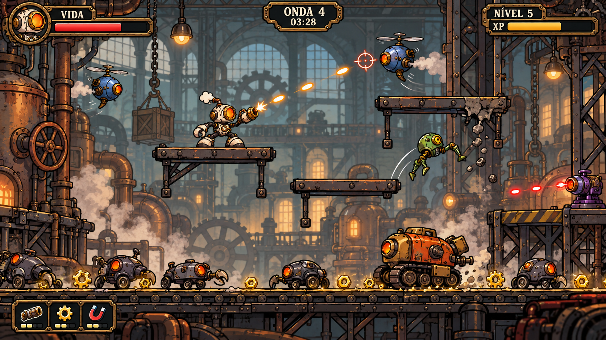

# Visão do jogo — uma partida na oficina

## O que esta imagem representa

Esta é a composição conceitual aprovada para uma partida de **Oficina em Pane**. Ela reúne a estética, a distribuição da arena e os elementos que o jogador encontra durante uma onda.

## Conceito

O pequeno robô-caldeira enfrenta máquinas defeituosas dentro de uma oficina industrial. Ele pode subir nas plataformas para escapar dos inimigos terrestres, mas precisa descer para coletar as peças douradas que permitem evoluir.

A imagem expressa a decisão central do jogo: **segurança no alto e evolução no chão**. Inimigos saltadores e voadores pressionam quem permanece nas plataformas.

## O que observar

| Elemento | O que comunica |
| --- | --- |
| Robô na plataforma, mirando na diagonal | Movimento de plataforma e tiro manual com mira livre |
| Plataformas em alturas diferentes | Rotas de fuga e uso da altura durante o combate |
| Inimigos no chão e no ar | Hordas com comportamentos e silhuetas distintos |
| Peças douradas no chão | XP coletável em uma área de risco |
| Fundo com máquinas, janelas e vapor | Identidade da oficina e sensação de profundidade |
| Vida, onda, tempo, nível e XP | Informações para acompanhar a partida |
| Ícones de peças no canto inferior | Melhorias instaladas no robô |

## Relação com a câmera

A ilustração representa um enquadramento da arena. Durante a partida, o robô poderá caminhar para os lados e a câmera acompanhará seu movimento, mostrando outras partes da oficina. O fundo terá camadas com parallax, enquanto a interface ficará fixa na tela.

A referência inicial de largura é de aproximadamente 1,5 a 2 telas, conforme o [GDD](../../GDD.md).

## Uso e situação

- **Situação:** composição conceitual aprovada pelo usuário.
- **Formato:** PNG horizontal, com toda a composição em uma única imagem.
- **Uso:** referência de direção de arte, organização da cena e apresentação do projeto.
- **Montagem do jogo:** herói, inimigos, cenário, plataformas, projéteis, itens e interface serão objetos ou imagens próprios.
- A imagem é uma visualização conceitual; os números da interface são ilustrativos e ela ainda não é uma captura do jogo em execução.

## Arquivos e origem

- [Imagem PNG](oficina-em-pane-gameplay-conceito-v1.png)
- [Prompt da geração por IA](PROMPT.md)
- Referência de identidade: [robô-caldeira aprovado](../heroi/README.md).
- Ferramenta: geração de imagens integrada ao Codex.

[Voltar ao catálogo](../README.md)
